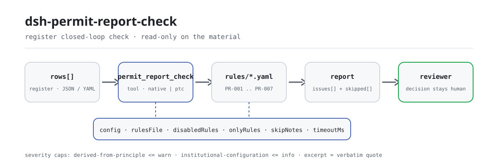

<div align="center">

<picture>
  <source media="(prefers-color-scheme: dark)" srcset="docs/assets/dsh-permit-report-check-flow-dark.svg">
  
</picture>

# dsh-permit-report-check

**Check an administrative licensing register row by row — you get a list of which row, which column, and what is off; the permit decision stays with the approver.**

A data-only checker plugin for DeepSeek Harness: it reads one administrative licensing register (an applicant header plus one row per application item), applies the versioned rule pack it ships (PR-001..PR-007), and lists only the differences it can point to inside the register — never a compliance verdict, never a liability finding.

[Install](#three-step-setup) · [Configuration](#configuration) · [FAQ](#faq) · [简体中文](README.md) · [English](README.en.md) · [Español](README.es.md) · [Português](README.pt.md) · [हिन्दी](README.hi.md)

[](LICENSE)
[](#compatibility)
[](https://www.npmjs.com/package/dsh-permit-report-check)
[](https://github.com/PerryLink/dsh-permit-report-check/actions/workflows/ci.yml)
[](#compatibility)

[](https://github.com/PerryLink/dsh-permit-report-check/stargazers)
[](https://www.npmjs.com/package/dsh-permit-report-check)
[](https://dshfind.com/plugins/PerryLink/dsh-permit-report-check?ref=badge)
[](https://securityscorecards.dev/viewer/?uri=github.com/PerryLink/dsh-permit-report-check)
[](https://dsh.market/)
[](https://gitee.com/perrylink/dsh-permit-report-check)

```sh
dsh plugin --profile <name> add dsh-permit-report-check
```

</div>

<sub>Community plugin, not affiliated with DeepSeek. Canonical repository: <https://github.com/PerryLink/dsh-permit-report-check> (Gitee is a mirror).</sub>

## What it is

`dsh-permit-report-check` reads one administrative licensing register — the applicant header plus one row per application item — and checks that register's own closed loop and internal consistency: that each item listed in the applied-materials column records whether it was submitted, that the acceptance date does not fall after the decision date, that the decision date falls between acceptance and the promised completion date the register itself records, that the decision outcome comes from the vocabulary you configured, that a record whose outcome marks a grant carries its certificate number, that the header names its applicant and matter, and that no licensing matter is registered twice in the table.

- **Who it is for**: administrative approval staff and compliance officers; no command line required — hand the material over in chat.
- **What you give it**: the source material the check works on (a table, register or document); the original is never modified. Excel can be converted to JSON/YAML first, in chat if the platform supports it.
- **What you get back**: a list of "which row, which column, what is off"; every check that could not run is listed in `skipped` with its reason.
- **What it does not do**: no compliance verdict, no liability finding, no replacement for the reviewer; differences only.

## Three-step setup

1. **Install** (pick one channel):

   ```sh
   # git channel (latest main; equivalent to git+https://github.com/PerryLink/dsh-permit-report-check.git)
   dsh plugin --profile <name> add github:PerryLink/dsh-permit-report-check
   # npm channel (published releases)
   dsh plugin --profile <name> add dsh-permit-report-check
   # tarball channel: pnpm pack in this repo, then
   dsh plugin --profile <name> add ./dsh-permit-report-check-<version>.tgz
   ```

2. **Minimal config** (sane defaults; a bundle row without `config` uses every default, with the rule-pack path pointing at the bundled `rules/permit-report-check.yaml`):

   ```yaml
   - insert:
       - id: dsh-permit-report-check
         name: dsh-permit-report-check
   ```

3. **Verify it mounts**:

   ```sh
   dsh --profile <name> --dump-config | grep 'dsh-permit-report-check'
   ```

   Then run the bundled sample (build `lib/` first with `pnpm run build`):

   ```sh
   node samples/quickstart/run.mjs
   ```

   Output (matching `samples/quickstart/expected/result.json`):

   ```text
   permit_report_check: 1 issue(s) — error 0, warn 1, info 0
   skipped: 1
   ```

   Screenshot: `docs/assets/quickstart.png`.

**Uninstall**: `dsh plugin --profile <name> remove dsh-permit-report-check` (or remove the row from the profile patch).

<details>
<summary>Use it in WorkBuddy / Coze</summary>

Search for "Professional Document Check Suite" in WorkBuddy / Coze (the full set; this check is one part of it; availability as listed) to reach the same checking capability without a command line.

</details>

<details>
<summary>Install from the DSH Desktop market</summary>

Every PerryLink plugin is listed in the built-in DSH Desktop market: **Market → Sources → Add source → paste** `https://perrylink-dsh-catalog.perrylink.workers.dev/catalog-source.json` **→ select**. Installation still requires the market's npm identity check and your confirmation.

</details>

## Core capabilities

`dsh-permit-report-check` registers the `permit_report_check` tool: it reads one administrative licensing register (the applicant header plus one row per application item), applies the versioned rule pack, and returns a report.

- **Seven rules in one pack** — the rule pack is data, not code (`rules/permit-report-check.yaml`); replacing it switches the whole rule set without touching a line of TypeScript.
- **Read-only on the material** — accepts JSON or YAML and never modifies the original; pure ESM, no network requests, no model calls.
- **No fabricated citations** — every rule carries `document` / `number` / `clause` / `excerpt` / `kind` / `source`; `excerpt` must be a verbatim quotation, and a rule whose text could not be obtained says so in `excerpt` and is marked `derived-from-principle`.
- **Severity follows the evidence** — `derived-from-principle` is capped at `warn`, institutional configuration (`institutional-configuration`) at `info`, and a test asserts the cap.
- **Empty list ≠ nothing is wrong** — every check that could not run lands in `skipped` with its reason; a rule whose required list is unset reports itself in `skipped` rather than passing silently.
- **No adjudicating wording** — the report lists differences only, never a judgment on compliance, liability or correctness; a wording guard enforces this and every report carries the disclaimer.

| Rule | Check | Severity | Basis kind |
|---|---|---|---|
| `PR-001` | each listed material records its submission | warn | principle |
| `PR-002` | acceptance does not follow the decision | warn | principle |
| `PR-003` | the decision falls between acceptance and the promised date | info | local |
| `PR-004` | the outcome comes from your vocabulary (off by default) | info | local |
| `PR-005` | a grant records its certificate number | warn | principle |
| `PR-006` | the register names its applicant and matter | warn | principle |
| `PR-007` | matters are not double-registered | warn | principle |

### Tool surface

`permit_report_check` takes four arguments and is read-only throughout:

| Argument | Type | Notes |
|---|---|---|
| `file` | string | Absolute path of the material file (JSON or YAML); one of `file` / `material` |
| `material` | string | Inline material text (JSON or YAML); one of `file` / `material` |
| `rulesFile` | string | Overrides the configured rule-pack path (relative to the package root, or absolute) |
| `only` | string[] | Run only these rule ids; empty keeps the configured `onlyRules` |

### Examples

These are the plugin's real entry points; install once, then call one. The first row is the detailed walkthrough, the rest are short cases.

**Detailed example** — tool `permit_report_check`, input:

```json
{"applicant":"某某公司","matter":"某某建设项目环评审批","rows":[{"序号":"1","许可事项":"建设项目环境影响评价文件审批","申请材料":"环境影响报告书全本及公众参与说明","已提交材料":""}]}
```

Output:

```json
{
  "id": "dsh-permit-report-check.PR-001.de09b5a6",
  "ruleId": "PR-001",
  "severity": "warn",
  "locator": {
    "row": 1,
    "field": "requiredItems"
  },
  "found": "第 1 行「requiredItems」为「环境影响报告书全本及公众参与说明」，但缺 submittedItems",
  "expected": "满足该条件的行应同时填写 submittedItems"
}
```

*Observed from `dsh-permit-report-check/tests/fixtures/PR-001/PR-001-unsafe.json`*

This is the plugin's real output on its own `PR-001` fixture, not an illustration. The rule pack does not invent citations, so every finding states both the provision it invokes and that the provision's text was not obtained this time.

| You ask | What it answers |
|---|---|
| A row lists materials in the applied-materials column, but the submitted-materials column is blank — is that reported? | Yes. `PR-001` requires a `submittedItems` value on every row whose materials cell is filled, and reports the row when the submission column is empty. It reads the register's own materials column and checks only whether the submission is recorded: it does not compare that list with the matter's service guide, and does not judge whether the materials submitted are complete or compliant. If no row has a filled materials cell, the rule reports itself in `skipped`. |
| The acceptance date is later than the decision date — will that be caught? | Yes. `PR-002` compares the two dates the register itself carries, `acceptedAt` against `decidedAt`, treats the same day as not later, and reports the row where acceptance follows the decision. It only compares those two dates: it does not judge whether the acceptance was lawful or whether the application should have been accepted. A date it cannot parse is reported as its own finding rather than skipped silently. |
| What happens when the promised completion date column is empty — and is the statutory-limit column checked at all? | `PR-003` reports itself in `skipped`: no day count is built in, because statutory periods are counted in working days, may be extended and may exclude hearing or expert-review time, so the only baseline is the promised completion date (`dueAt`) the register states. No rule reads the statutory-limit (`legalDays`) column. When `dueAt` is filled, the rule checks that the decision date falls between acceptance and it; a finding means the decision disagrees with the deadline you recorded, never that it was late. |
| I recorded an outcome such as "granted after correction" — is that accepted? | `PR-004` checks the decision outcome against the vocabulary in its `values` parameter, and that parameter ships empty — so as delivered the rule reports itself in `skipped` instead of judging your wording. Fill `values` with the outcomes your institution records and any value not on that list is reported. The rule checks only whether the value is on the list; it does not judge whether the decision is correct or lawful. |
| A record says granted, but the certificate-number column is blank. | `PR-005` reports it: when the decision outcome matches a grant marker — `conditionValues`, whose shipped default set is listed under Configuration — the record must carry its certificate number (`certificateNo`). It checks only that the number is filled in, not whether the certificate is genuine, valid or served. With no row matching a grant marker, the rule reports itself in `skipped`. |
| The same licensing matter appears in two rows. | `PR-007` reports the later row and names the row it duplicates, because two registrations of one matter make the deadline check ambiguous. It checks uniqueness only, and a hit needs human confirmation: one project applying for several matters may legitimately look the same, so distinguish it in the materials column rather than deleting the row. Differences in whitespace are ignored; with no matter column the rule reports itself in `skipped`. |

## Standards it follows

| Document | Number | Cited by rules |
|---|---|---|
| Administrative Licensing Law of the People's Republic of China | Current version and article numbers not verified this time | PR-001, PR-002, PR-005, PR-006, PR-007 |
| Each matter's service guide and promised time limit (institutional configuration) | No national standard (the basis is the promised completion date written in the register) — ⚠️ the statutory ceiling is in article 42 of the Administrative Licensing Law; this rule does not cite it | PR-003 |
| This institution's licensing-management policy (institutional configuration) | No national standard (the basis is the institution's own outcome vocabulary) — ⚠️ the statutory decision types are in article 38; this rule does not cite them | PR-004 |

**Boundary:** this plugin checks an **administrative licensing register** for the closed loop a register can be held to — that each application item records its submission, that acceptance does not follow the decision, that the decision falls between acceptance and the promised completion date, that the decision outcome comes from your vocabulary, that a grant records its certificate number, that the register names its applicant and matter, and that matters are not double-registered. It does **not** decide whether a permit decision was lawful, whether the materials were complete or compliant, whether an application should be accepted, or whether a permit should be granted.

> ### ⚠️ What this plugin deliberately does not judge
>
> **It does not check whether the materials list is complete.** It reads the register's **own** applied-materials column and checks that each listed item records whether it was submitted — **not** whether that list matches the matter's service guide. Verifying the list means comparing it against the guide, which this plugin does not do.
>
> **No statutory period is built in — and the statute says why that is the right call.** The Administrative Licensing Law of the People's Republic of China was read verbatim (see `rules/evidence/clause-verification.md`), and three of its provisions make a built-in number unusable: **article 82 requires statutory periods to be counted in working days, excluding public holidays**; article 42 sets twenty days with a ten-day extension (forty-five plus fifteen for joint handling); and article 45 excludes time needed for hearings, testing, inspection and expert review from the period altogether. A register normally records calendar dates, so `PR-003` compares the decision date against the **promised completion date written in the register**, and reports itself in `skipped` when that column is empty. A finding means "this disagrees with the deadline you recorded", never "this was late".
>
> ⚠️ **The text read was the 2003 promulgation**; a 2019 amendment exists and **was not obtained**, so the pack keeps the note that the current version and article numbers were not verified on every rule, and claims no article is current law.
>
> **The outcome vocabulary ships empty.** Wording for grants, refusals and terminations varies by institution and matter, so `PR-004` reports itself in `skipped` until you configure it, and `PR-005` (which requires a certificate number once a grant is recorded) uses a configurable set of grant marker values rather than a built-in list.
>
> **Every `excerpt` in the rule pack says, in so many words, that the clause text was not obtained.** The regime lives in the Administrative Licensing Law and in each matter's service guide. The verification pass could not retrieve verbatim clause text, so the pack states the gap in the `excerpt` field itself and keeps every rule at `warn` or `info`. **When the texts are in hand, replace each `excerpt` with the real clause and raise `kind` to `direct`.**

## Configuration

All tunables are Schemastery `Config` fields in `src/config.ts` (changeable from cordis.yml); per-rule thresholds live in the rule pack under `rules/`. An id-targeted override replaces the whole row — restate every key you need.

| Key | Type | Default | Description |
|---|---|---|---|
| `rulesFile` | string | `rules/permit-report-check.yaml` | Rule-pack path, relative to the package root |
| `disabledRules` | string[] | `[]` | Rule ids to stop running; each appears in `skipped` |
| `onlyRules` | string[] | `[]` | Run only these rule ids; empty runs every rule |
| `skipNotes` | string | `""` | Note appended to every `skipped` reason |
| `timeoutMs` | number | `120000` | Cooperative tool timeout budget |

Rule-level parameters worth knowing:

- `PR-001` `conditionField` / `requiredFields` — which column triggers the requirement: a filled applied-materials cell requires the submission column.
- `PR-003` `notAfterField` — compared against `dueAt` (the promised completion date); the plugin never derives a deadline from a day count.
- `PR-004` `values` — your decision-outcome vocabulary; empty means no check. Example shape:

```yaml
values: [granted, refused, not accepted, terminated, granted after correction]
```

- `PR-005` `conditionValues` — the values that mark a grant. The shipped default set is:

```text
准予 / 准予许可 / 通过 / 同意 / 已办结 / 批准
```

- `PR-006` `fields` — fields that must appear in the header, default `[applicant, matter]`; add `window` if your form also records the intake window.
- `PR-007` `field` — the column required to be unique, by default the licensing-matter column (`permitType`).

Example override in your profile patch:

```yaml
- insert:
    - id: dsh-permit-report-check
      name: dsh-permit-report-check
      config:
        disabledRules: [PR-004]
        timeoutMs: 180000
```

## Material format

The tool accepts JSON or YAML:

```yaml
applicant: 某某公司
matter: 某某建设项目环评审批
window: 综合受理窗口
rows:
  - { 序号: '1', 许可事项: 建设项目环境影响评价文件审批, 许可机关: 某某生态环境局,
      法定依据: 《中华人民共和国环境影响评价法》第二十二条,
      申请材料: 环境影响报告书全本及公众参与说明,
      已提交材料: 已提交报告书全本（含公众参与说明），受理编号 SL-2026-018,
      受理日期: 2026-03-02, 法定时限: '60', 承诺办结日: 2026-04-30,
      决定日期: 2026-04-20, 决定结果: 准予, 许可证号: 某环审〔2026〕18 号, 承办人: 王工 }
```

Column names are matched case-insensitively and ignoring spaces, underscores and hyphens; the register's own column names are kept, so a finding names the column it read. Fields are optional at the reader layer and validated by the check engine, so a partial export produces "missing item" differences rather than crashing the tool.

## Rule sources

Rule data lives in `rules/permit-report-check.yaml`, separate from code: every rule carries document, number, the clause number as the source's own numbering system has it, a verbatim excerpt and a source URL. The pack's header states the citation gap in full, and each rule's `note` repeats the part that matters for that rule. The load-time guard that normally enforces "an excerpt must be a real quotation of at least eight characters" cannot tell a quotation from a description — so this pack leans on the header, the per-rule notes and a test that asserts every `excerpt` admits the gap. A rule pack that overstates its basis fails at load rather than producing a confident-looking report. The boundaries established during verification and the conclusions deliberately not drawn ship in `rules/evidence/`.

## FAQ

<details>
<summary>Will it decide grant or refusal for us?</summary>

No. It lists only the differences it can point to inside the material (which row, which column, what is off), makes no factual finding and evaluates no lawfulness — the permit decision stays with the approver. A wording guard constrains how the report is phrased, and every report carries the disclaimer.

</details>

<details>
<summary>My register is an Excel file — can I use it directly?</summary>

Yes: convert it to JSON or YAML first; where the platform supports it, the conversion can happen in chat. The tool only reads the material and never modifies the original.

</details>

<details>
<summary>Why is no statutory day count built in?</summary>

Because the law itself makes a built-in number unusable: article 82 counts statutory periods in working days, excluding public holidays; article 42 sets twenty days with a ten-day extension (forty-five plus fifteen for joint handling); and article 45 excludes hearing, testing, inspection and expert-review time from the period. A register normally records calendar dates, so `PR-003` compares only against the promised completion date (`dueAt`) the register states; when that column is empty the rule lands in `skipped` rather than assuming a deadline for you.

</details>

<details>
<summary>Can an empty `issues` list be read as "nothing is wrong"?</summary>

No. Every check that could not run is listed in `skipped` with its reason (an empty promised completion date, an unconfigured `values` list, a disabled rule). Read `issues` and `skipped` together.

</details>

<details>
<summary>Does it go online or upload the register? How much overhead is there?</summary>

No network, no model calls, no file writes: reading, comparison and calendar arithmetic all happen locally, and the material arrives only through the tool arguments. For a whole quarter of registers or a whole directory, `ptc` mode pays the schema cost once; `timeoutMs` (default 120000 ms) is a cooperative timeout budget.

</details>

## Troubleshooting

- **The plugin installs but the tool never appears.** Check that `main` resolves to `lib/index.mjs` and that `pnpm run build` produced it; a wrong `main` makes the loader skip the entry silently.
- **`dsh plugin add` refuses the package as incompatible.** The peer range covers `0.1.x` and `0.2.x`; if your runtime sits outside it, grant an explicit exemption: `dsh plugin --profile <name> allow-version dsh-permit-report-check@0.1.0 --dsh-version <runtime> --accept-risk`
- **`check` reports `manifest-peers` as failed.** The static checker compares against a hard-coded peer range that predates the 0.2 line. The runtime enforces peer compatibility at install time, so the declared range is the correct one; this is a known upstream issue in `dsh-plugin-dev`.
- **A rule did not run.** Look at the `skipped` array; it names the rule id and the reason.
- **It installed but I see no findings.** Confirm the tool actually ran and returned a result — an empty result is not the same as a skipped run — then check the material's column names against the rule table; missing input is usually reported as `skipped` rather than guessed into a finding.
- **`PR-003` reports itself in `skipped`.** The register records no promised completion date. Periods differ by matter and may be extended, so the plugin will not supply one.
- **`PR-003` fires but I consider the handling timely.** The finding means the decision date disagrees with the promised completion date recorded in the register — either the deadline was worked out wrongly or the decision date is wrong.
- **`PR-001` did not catch a missing material.** It checks the register's own list, not the service guide's; whether the list is complete is a comparison this plugin does not make.
- **`PR-004` never runs.** Its vocabulary ships empty; fill `values` with the outcomes your institution records.
- **`PR-005` fires on a grant with no certificate number.** Either the certificate was not issued yet or the column was left blank. Narrow `conditionValues` if your register uses a different grant wording.
- **A finding says the clause text was not obtained.** The rule pack has a citation gate and never invents clause text; when the text is unavailable the finding stays at `warn`/`info` and says so in its `excerpt`. Treat that as a verification gap, not as proof that the material is compliant.
- **Everything is `warn` or `info`.** By design: this checker makes no legal determination; it reports differences and a human decides what to do with them.
- **Timestamps look shifted.** All arithmetic is wall-clock work on the input strings; no time-zone conversion is applied.

## Compatibility

| Surface | Status |
|---|---|
| Harness | Peer range `>=0.1.2-rc.1 <0.2.0 \|\| >=0.2.0-0 <0.3.0` — verified to accept both `0.2.0-rc.2` and `0.2.1-rc.2`. `engines.dsh` is declared as `>=0.2.1-0 <0.3.0` and is enforced by the host since 0.2.1 |
| Node | `^22.19.0 \|\| >=24.0.0` |
| Platforms | All (plain ESM; no native code, no network, no model call) |
| Tool mode | Works in `native` and `ptc`; for a whole directory of registers use `ptc` |

**Interoperability**: the package declares exactly one capability, `tools:register` (`package.json#dsh.capabilities`), registers a single namespaced tool `permit_report_check`, provides no service key, registers no client slot and no `webServer` prefix, and its bundle patch only `insert`s its own row — it never overrides a built-in row's `config`. It therefore contends with no other plugin over tool names, service keys, slots or HTTP routes.

## Ecosystem & quality

- [Gitee mirror](https://gitee.com/perrylink/dsh-permit-report-check) (sync mirror; GitHub is canonical)
- [dshfind plugin page](https://dshfind.com/plugins/PerryLink/dsh-permit-report-check) (installs and ranking)
- [OpenSSF Scorecard report](https://securityscorecards.dev/viewer/?uri=github.com/PerryLink/dsh-permit-report-check) (driven by [.github/workflows/scorecard.yml](.github/workflows/scorecard.yml))
- [DSH Market](https://dsh.market/) (listed)
- **1024 store channel**: `npm i -g dsh1024` once, then `dsh1024 plugin --profile <name> add dsh-permit-report-check` (counts toward the [deepseek1024.com](https://deepseek1024.com) install ranking)
- [Ecosystem knowledge base](https://perrylink.github.io/dsh-plugin-guide/) — measured data, not marketing: plugin development guide · plugin-selection data · maintenance criteria

## Development

```sh
pnpm install                                        # node ^22.19 || >=24
pnpm run typecheck                                  # tsc --noEmit
pnpm test                                           # vitest: shared table-plugin suite + paired fixtures
pnpm run build                                      # tsdown -> lib/index.mjs + lib/index.d.mts
pnpm run verify:self-contained                      # dependency specs resolve from the registry
pnpm run check:lockfile                             # lockfile drift check
pnpm run check:readmes                              # five-language README consistency
pnpm run check:citations                            # rule-pack citation baseline
node ../scripts/sync-shared.mjs dsh-permit-report-check   # refresh src/shared from ../_shared
pnpm pack                                           # the published tarball
```

The plugin is **data-only**: `src/model.ts` declares the table shape, the shared kit supplies the reader and the check engine, and the rule pack declares every check; a check that fits an existing type needs only a rule-pack edit. Local sample run (build `lib/` first):

```sh
node samples/quickstart/run.mjs --json
# => {"tool":"permit_report_check","issueCount":1,"summary":{"error":0,"warn":1,"info":0},"skippedCount":1}
```

Sample input lives in `samples/quickstart/input/`, the expected output in `samples/quickstart/expected/result.json`, and the screenshot in `docs/assets/quickstart.png`. The README images are generated programmatically by [`scripts/gen-readme-assets.py`](scripts/gen-readme-assets.py) (Python + Pillow) and are safe to re-run: `python scripts/gen-readme-assets.py`; the older single-skin flow diagram and demo images stay in `docs/assets/` for external links, while the READMEs reference only the new light/dark pair.

Topics: `deepseek-harness`, `dsh`, `dsh-plugin`, `cordis`, `permit`, `report`

## Family & thanks

This project is part of the DeepSeek Harness plugin family from [PerryLink](https://github.com/PerryLink) (all Apache-2.0). The full family index is [choose a checker by material](https://perrylink.github.io/zh/checkers/choose/). If it is useful, **a star helps the next person find it** — nothing is gated behind it.

- [@PerryLink](https://github.com/PerryLink) — creator and maintainer: the data-only rule pack (PR-001..PR-007), the `permit_report_check` tool, the citation-verification record (`rules/evidence/`), and the five-language docs.

<details>
<summary>Expand all plugins</summary>

| Plugin | Status |
|---|---|
| **[dsh-aqua-input-check](https://github.com/PerryLink/dsh-aqua-input-check)** |  |
| **[dsh-archive-check](https://github.com/PerryLink/dsh-archive-check)** |  |
| **[dsh-auto-review](https://github.com/PerryLink/dsh-auto-review)** |  |
| **[dsh-autotier](https://github.com/PerryLink/dsh-autotier)** | 🧊 FROZEN — see the repo README |
| **[dsh-bid-ca-precheck](https://github.com/PerryLink/dsh-bid-ca-precheck)** |  |
| **[dsh-bid-qual-check](https://github.com/PerryLink/dsh-bid-qual-check)** |  |
| **[dsh-cert-mcp](https://github.com/PerryLink/dsh-cert-mcp)** | 🧊 FROZEN — see the repo README |
| **[dsh-checkpoint-rewind](https://github.com/PerryLink/dsh-checkpoint-rewind)** |  |
| **[dsh-click](https://github.com/PerryLink/dsh-click)** |  |
| **[dsh-composer-history](https://github.com/PerryLink/dsh-composer-history)** |  |
| **[dsh-contract-stance](https://github.com/PerryLink/dsh-contract-stance)** |  |
| **[dsh-customs-doc-check](https://github.com/PerryLink/dsh-customs-doc-check)** |  |
| **[dsh-data-quality](https://github.com/PerryLink/dsh-data-quality)** | 🧊 FROZEN — see the repo README |
| **[dsh-demurrage-ledger](https://github.com/PerryLink/dsh-demurrage-ledger)** |  |
| **[dsh-doublecheck](https://github.com/PerryLink/dsh-doublecheck)** |  |
| **[dsh-drill-script-check](https://github.com/PerryLink/dsh-drill-script-check)** |  |
| **[dsh-eia-guide-check](https://github.com/PerryLink/dsh-eia-guide-check)** |  |
| **[dsh-emergency-plan](https://github.com/PerryLink/dsh-emergency-plan)** |  |
| **[dsh-essay-rubric-check](https://github.com/PerryLink/dsh-essay-rubric-check)** |  |
| **[dsh-evidence-check](https://github.com/PerryLink/dsh-evidence-check)** |  |
| **[dsh-export-ctl-check](https://github.com/PerryLink/dsh-export-ctl-check)** |  |
| **[dsh-fast](https://github.com/PerryLink/dsh-fast)** |  |
| **[dsh-fmea-table-check](https://github.com/PerryLink/dsh-fmea-table-check)** |  |
| **[dsh-forecast-penalty](https://github.com/PerryLink/dsh-forecast-penalty)** |  |
| **[dsh-fund-research](https://github.com/PerryLink/dsh-fund-research)** |  |
| **[dsh-github](https://github.com/PerryLink/dsh-github)** |  |
| **[dsh-gongwen-flow-check](https://github.com/PerryLink/dsh-gongwen-flow-check)** |  |
| **[dsh-gongwen-word-check](https://github.com/PerryLink/dsh-gongwen-word-check)** |  |
| **[dsh-guard-plan-qc](https://github.com/PerryLink/dsh-guard-plan-qc)** |  |
| **[dsh-hazchem-check](https://github.com/PerryLink/dsh-hazchem-check)** |  |
| **[dsh-hazplan-check](https://github.com/PerryLink/dsh-hazplan-check)** |  |
| **[dsh-hidden-risk-map](https://github.com/PerryLink/dsh-hidden-risk-map)** |  |
| **[dsh-hs-classify](https://github.com/PerryLink/dsh-hs-classify)** |  |
| **[dsh-icd-rule-check](https://github.com/PerryLink/dsh-icd-rule-check)** |  |
| **[dsh-industry-research](https://github.com/PerryLink/dsh-industry-research)** |  |
| **[dsh-lawcite-adapter](https://github.com/PerryLink/dsh-lawcite-adapter)** |  |
| **[dsh-laya](https://github.com/PerryLink/dsh-laya)** |  |
| **[dsh-lc-doc-check](https://github.com/PerryLink/dsh-lc-doc-check)** |  |
| **[dsh-learning-gap-check](https://github.com/PerryLink/dsh-learning-gap-check)** |  |
| **[dsh-library](https://github.com/PerryLink/dsh-library)** |  |
| **[dsh-local-ai](https://github.com/PerryLink/dsh-local-ai)** |  |
| **[dsh-lsp-actions](https://github.com/PerryLink/dsh-lsp-actions)** |  |
| **[dsh-mask](https://github.com/PerryLink/dsh-mask)** |  |
| **[dsh-mcp-panel](https://github.com/PerryLink/dsh-mcp-panel)** |  |
| **[dsh-medrec-qc](https://github.com/PerryLink/dsh-medrec-qc)** |  |
| **[dsh-memento](https://github.com/PerryLink/dsh-memento)** | 🧊 FROZEN — see the repo README |
| **[dsh-nsfc-form-check](https://github.com/PerryLink/dsh-nsfc-form-check)** |  |
| **[dsh-nurse-record-check](https://github.com/PerryLink/dsh-nurse-record-check)** |  |
| **[dsh-observe](https://github.com/PerryLink/dsh-observe)** |  |
| **[dsh-origin-rvc-check](https://github.com/PerryLink/dsh-origin-rvc-check)** |  |
| **[dsh-ota-review-check](https://github.com/PerryLink/dsh-ota-review-check)** |  |
| **[dsh-output-styles](https://github.com/PerryLink/dsh-output-styles)** |  |
| **[dsh-paper-doc-adapter](https://github.com/PerryLink/dsh-paper-doc-adapter)** |  |
| **[dsh-permission-rules](https://github.com/PerryLink/dsh-permission-rules)** |  |
| **[dsh-permit-report-check](https://github.com/PerryLink/dsh-permit-report-check)** |  |
| **[dsh-pipeline-check](https://github.com/PerryLink/dsh-pipeline-check)** |  |
| **[dsh-pleading-draft](https://github.com/PerryLink/dsh-pleading-draft)** |  |
| **[dsh-plugin-doctor](https://github.com/PerryLink/dsh-plugin-doctor)** | 🚫 RETIRED (repo archived) |
| **[dsh-plugin-guide](https://github.com/PerryLink/dsh-plugin-guide)** |  |
| **[dsh-plugin-kit](https://github.com/PerryLink/dsh-plugin-kit)** | 🚫 RETIRED (repo archived) |
| **[dsh-plugin-upgrade](https://github.com/PerryLink/dsh-plugin-upgrade)** | 🚫 RETIRED (repo archived) |
| **[dsh-policy-brief-draft](https://github.com/PerryLink/dsh-policy-brief-draft)** |  |
| **[dsh-power-loss-split](https://github.com/PerryLink/dsh-power-loss-split)** |  |
| **[dsh-power-ticket-check](https://github.com/PerryLink/dsh-power-ticket-check)** |  |
| **[dsh-ppap-check](https://github.com/PerryLink/dsh-ppap-check)** |  |
| **[dsh-protest-deadline](https://github.com/PerryLink/dsh-protest-deadline)** |  |
| **[dsh-railway-window](https://github.com/PerryLink/dsh-railway-window)** |  |
| **[dsh-repair-order-qc](https://github.com/PerryLink/dsh-repair-order-qc)** |  |
| **[dsh-research-report](https://github.com/PerryLink/dsh-research-report)** |  |
| **[dsh-review-reply-check](https://github.com/PerryLink/dsh-review-reply-check)** |  |
| **[dsh-rulefile-check](https://github.com/PerryLink/dsh-rulefile-check)** |  |
| **[dsh-safety-brief-check](https://github.com/PerryLink/dsh-safety-brief-check)** |  |
| **[dsh-score](https://github.com/PerryLink/dsh-score)** | 🧊 FROZEN — see the repo README |
| **[dsh-session-sync](https://github.com/PerryLink/dsh-session-sync)** |  |
| **[dsh-site-log-check](https://github.com/PerryLink/dsh-site-log-check)** |  |
| **[dsh-skill-pack-security](https://github.com/PerryLink/dsh-skill-pack-security)** |  |
| **[dsh-soe-decision-check](https://github.com/PerryLink/dsh-soe-decision-check)** |  |
| **[dsh-soilwater-check](https://github.com/PerryLink/dsh-soilwater-check)** |  |
| **[dsh-sop-sync-check](https://github.com/PerryLink/dsh-sop-sync-check)** |  |
| **[dsh-spc-gbt-adapter](https://github.com/PerryLink/dsh-spc-gbt-adapter)** |  |
| **[dsh-talk](https://github.com/PerryLink/dsh-talk)** |  |
| **[dsh-tender-extract](https://github.com/PerryLink/dsh-tender-extract)** |  |
| **[dsh-tender-matrix](https://github.com/PerryLink/dsh-tender-matrix)** |  |
| **[dsh-test-drive](https://github.com/PerryLink/dsh-test-drive)** |  |
| **[dsh-ticktick](https://github.com/PerryLink/dsh-ticktick)** | 🚫 RETIRED (repo archived) |
| **[dsh-translate](https://github.com/PerryLink/dsh-translate)** |  |
| **[dsh-warranty-calc](https://github.com/PerryLink/dsh-warranty-calc)** |  |
| **[dsh-budget](https://github.com/PerryLink/dsh-budget)** | 🧊 FROZEN — see the repo README |
| **[dsh-claude-move](https://github.com/PerryLink/dsh-claude-move)** | 🧊 FROZEN — see the repo README |
| **[dsh-defend](https://github.com/PerryLink/dsh-defend)** | 🧊 FROZEN — see the repo README |
| **[dsh-draw](https://github.com/PerryLink/dsh-draw)** | 🧊 FROZEN — see the repo README |
| **[dsh-reach](https://github.com/PerryLink/dsh-reach)** | 🧊 FROZEN — see the repo README |
| **[dsh-background-agents](https://github.com/PerryLink/dsh-background-agents)** | 🚫 RETIRED (repo archived) |
| **[dsh-session-pin](https://github.com/PerryLink/dsh-session-pin)** | 🚫 RETIRED (repo archived) |
| **[dsh-team-rooms](https://github.com/PerryLink/dsh-team-rooms)** | 🚫 RETIRED (repo archived) |

</details>

## License

[LICENSE](LICENSE) (Apache License 2.0) © 2026 dsh-permit-report-check contributors

<p align="center"><sub>Apache-2.0 · Community plugin, not affiliated with DeepSeek.</sub></p>
