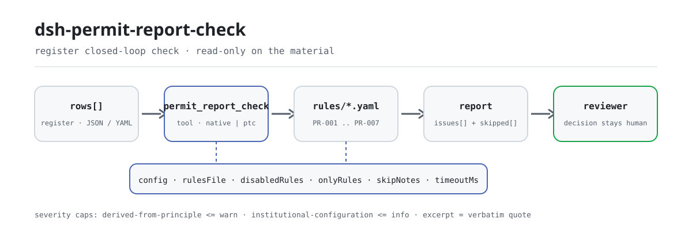

<div align="center">

<picture>
  <source media="(prefers-color-scheme: dark)" srcset="docs/assets/dsh-permit-report-check-flow-dark.svg">
  
</picture>

# dsh-permit-report-check

**Revisa un registro de licencias administrativas fila por fila: obtienes una lista de qué fila, qué columna y qué falta; la decisión sobre la licencia queda en manos del aprobador.**

Un plugin de verificación de solo datos para DeepSeek Harness: lee un registro de tramitación de licencias administrativas (la cabecera del solicitante más una fila por cada solicitud), aplica el paquete de reglas versionado que trae (PR-001..PR-007) y enumera solo las diferencias que puede señalar dentro del registro, sin dictamen de cumplimiento ni juicio de responsabilidad.

[Instalar](#instalación-en-tres-pasos) · [Configuración](#configuración) · [FAQ](#faq) · [简体中文](README.md) · [English](README.en.md) · [Español](README.es.md) · [Português](README.pt.md) · [हिन्दी](README.hi.md)

[](LICENSE)
[](#compatibilidad)
[](https://www.npmjs.com/package/dsh-permit-report-check)
[](https://github.com/PerryLink/dsh-permit-report-check/actions/workflows/ci.yml)
[](#compatibilidad)

[](https://github.com/PerryLink/dsh-permit-report-check/stargazers)
[](https://www.npmjs.com/package/dsh-permit-report-check)
[](https://dshfind.com/plugins/PerryLink/dsh-permit-report-check?ref=badge)
[](https://securityscorecards.dev/viewer/?uri=github.com/PerryLink/dsh-permit-report-check)
[](https://dsh.market/)
[](https://gitee.com/perrylink/dsh-permit-report-check)

```sh
dsh plugin --profile <name> add dsh-permit-report-check
```

</div>

<sub>Plugin de la comunidad, no afiliado a DeepSeek. Repositorio canónico: <https://github.com/PerryLink/dsh-permit-report-check> (Gitee es un espejo).</sub>

## Qué es

`dsh-permit-report-check` lee un registro de tramitación de licencias administrativas —la cabecera del solicitante y una fila por cada solicitud— y comprueba su propio circuito cerrado y su coherencia interna: que cada material listado en la columna de materiales solicitados registre si se presentó, que la fecha de aceptación no sea posterior a la fecha de decisión, que la fecha de decisión quede entre la aceptación y la fecha de finalización comprometida que el propio registro declara, que el resultado de la decisión provenga del vocabulario que configures, que un registro cuyo resultado indica concesión lleve su número de licencia, que la cabecera nombre al solicitante y el asunto, y que ningún asunto quede registrado dos veces.

- **Para quién**: personal de ventanilla de aprobación administrativa y de cumplimiento; no hace falta usar la línea de comandos: entrega el material en el chat.
- **Qué le das**: el material original sobre el que trabaja la comprobación (una tabla, un registro o un documento); el original nunca se modifica. Excel puede convertirse antes a JSON/YAML, incluso en el chat si la plataforma lo permite.
- **Qué devuelve**: una lista de «qué fila, qué columna, qué falta»; cada comprobación que no pudo ejecutarse aparece en `skipped` con su motivo.
- **Qué no hace**: no dictamina cumplimiento, no determina responsabilidad y no sustituye al revisor; solo enumera diferencias.

## Instalación en tres pasos

1. **Instala** (elige un canal):

   ```sh
   # canal git (último main; equivale a git+https://github.com/PerryLink/dsh-permit-report-check.git)
   dsh plugin --profile <name> add github:PerryLink/dsh-permit-report-check
   # canal npm (versiones publicadas)
   dsh plugin --profile <name> add dsh-permit-report-check
   # canal tarball: tras pnpm pack en este repo
   dsh plugin --profile <name> add ./dsh-permit-report-check-<version>.tgz
   ```

2. **Configuración mínima** (los valores por defecto ya funcionan; una fila bundle sin `config` usa todos los valores por defecto, con la ruta del paquete de reglas apuntando al `rules/permit-report-check.yaml` incluido):

   ```yaml
   - insert:
       - id: dsh-permit-report-check
         name: dsh-permit-report-check
   ```

3. **Verifica que se monta**:

   ```sh
   dsh --profile <name> --dump-config | grep 'dsh-permit-report-check'
   ```

   Después ejecuta el ejemplo incluido (primero `pnpm run build` para producir `lib/`):

   ```sh
   node samples/quickstart/run.mjs
   ```

   Salida (coincide con `samples/quickstart/expected/result.json`):

   ```text
   permit_report_check: 1 issue(s) — error 0, warn 1, info 0
   skipped: 1
   ```

   Captura: `docs/assets/quickstart.png`.

**Desinstalar**: `dsh plugin --profile <name> remove dsh-permit-report-check` (o elimina la fila del patch del perfil).

<details>
<summary>Usarlo en WorkBuddy / Coze</summary>

Busca «Professional Document Check Suite» en WorkBuddy / Coze (el conjunto completo; esta comprobación es una parte; disponibilidad según catálogo) para acceder a la misma capacidad sin línea de comandos.

</details>

<details>
<summary>Instalar desde el mercado de DSH Desktop</summary>

Todos los plugins de PerryLink pueden explorarse en el mercado integrado de DSH Desktop: **Market → Sources → add source → pegar** `https://perrylink-dsh-catalog.perrylink.workers.dev/catalog-source.json` **→ seleccionarlo**. La instalación sigue pasando por la verificación de identidad npm del mercado y tu confirmación.

</details>

## Capacidades clave

`dsh-permit-report-check` registra la herramienta `permit_report_check`: lee un registro de tramitación de licencias administrativas (la cabecera del solicitante más una fila por solicitud), aplica el paquete de reglas versionado y devuelve un informe.

- **Siete reglas en un solo paquete** — el paquete de reglas es dato, no código (`rules/permit-report-check.yaml`); sustituirlo cambia todo el conjunto de comprobaciones sin tocar una línea de TypeScript.
- **Solo lectura sobre el material** — acepta JSON o YAML y nunca modifica el original; ESM puro, sin peticiones de red ni llamadas al modelo.
- **Sin citas inventadas** — cada regla lleva `document` / `number` / `clause` / `excerpt` / `kind` / `source`; `excerpt` debe ser una cita literal, y una regla cuyo texto no se obtuvo lo dice en `excerpt` y se marca `derived-from-principle`.
- **La severidad sigue a la evidencia** — `derived-from-principle` se limita a `warn`, la configuración institucional (`institutional-configuration`) a `info`, y un test asegura ese límite.
- **Lista vacía ≠ nada va mal** — cada comprobación que no pudo ejecutarse queda en `skipped` con su motivo; una regla cuya lista requerida no está configurada se reporta en `skipped` en lugar de pasar en silencio.
- **Redacción que no dictamina** — el informe solo enumera diferencias, nunca juicios de cumplimiento, responsabilidad o corrección; un guardián de redacción lo impone y todo informe incluye el descargo de responsabilidad.

| Regla | Comprueba | Severidad | Tipo de base |
|---|---|---|---|
| `PR-001` | cada material listado registra su presentación | warn | principle |
| `PR-002` | la aceptación no es posterior a la decisión | warn | principle |
| `PR-003` | la decisión cae entre la aceptación y la fecha comprometida | info | local |
| `PR-004` | el resultado proviene de tu vocabulario (desactivada de fábrica) | info | local |
| `PR-005` | una concesión registra su número de licencia | warn | principle |
| `PR-006` | el registro nombra solicitante y asunto | warn | principle |
| `PR-007` | los asuntos no se registran dos veces | warn | principle |

### Superficie de la herramienta

`permit_report_check` acepta cuatro argumentos y es de solo lectura de principio a fin:

| Argumento | Tipo | Notas |
|---|---|---|
| `file` | string | Ruta absoluta del material (JSON o YAML); uno de `file` / `material` |
| `material` | string | Texto del material en línea (JSON o YAML); uno de `file` / `material` |
| `rulesFile` | string | Sustituye la ruta configurada del paquete de reglas (relativa a la raíz del paquete o absoluta) |
| `only` | string[] | Ejecuta solo estos ids de regla; vacío mantiene `onlyRules` configurado |

### Ejemplos

Son los puntos de entrada reales del plugin; instala una vez y llama a uno. La primera fila es el recorrido detallado, el resto son casos breves.

**Ejemplo detallado** — herramienta `permit_report_check`, entrada:

```json
{"applicant":"某某公司","matter":"某某建设项目环评审批","rows":[{"序号":"1","许可事项":"建设项目环境影响评价文件审批","申请材料":"环境影响报告书全本及公众参与说明","已提交材料":""}]}
```

Salida:

```json
{
  "id": "dsh-permit-report-check.PR-001.de09b5a6",
  "ruleId": "PR-001",
  "severity": "warn",
  "locator": {
    "row": 1,
    "field": "requiredItems"
  },
  "found": "第 1 行「requiredItems」为「环境影响报告书全本及公众参与说明」，但缺 submittedItems",
  "expected": "满足该条件的行应同时填写 submittedItems"
}
```

*Observed from `dsh-permit-report-check/tests/fixtures/PR-001/PR-001-unsafe.json`*

Es la salida real del plugin sobre su propio fixture `PR-001`, no una ilustración. El paquete de reglas no inventa citas, así que cada hallazgo indica tanto la disposición que invoca como que el texto de esa disposición no se obtuvo en esta revisión.

| Tú preguntas | Qué responde |
|---|---|
| Una fila lista materiales en la columna de materiales solicitados, pero la columna de materiales presentados está vacía: ¿se reporta? | Sí. `PR-001` exige un valor `submittedItems` en toda fila cuya celda de materiales esté rellena, y reporta la fila cuando la columna de presentación está vacía. Lee la columna de materiales del propio registro y solo comprueba si se registró la presentación: no compara esa lista con la guía de servicio del asunto ni juzga si los materiales presentados son completos o conformes. Si ninguna fila tiene la celda de materiales rellena, la regla se reporta en `skipped`. |
| La fecha de aceptación es posterior a la de decisión: ¿se detecta? | Sí. `PR-002` compara las dos fechas que el propio registro lleva, `acceptedAt` frente a `decidedAt`, considera que el mismo día no es posterior y reporta la fila en la que la aceptación sigue a la decisión. Solo compara esas dos fechas: no juzga si la aceptación fue legal ni si la solicitud debía aceptarse. Una fecha que no puede analizar se reporta como hallazgo propio, no se omite en silencio. |
| ¿Qué pasa si la columna de fecha de finalización comprometida está vacía, y se comprueba la columna de plazo legal? | `PR-003` se reporta en `skipped`: no hay ningún número de días incorporado, porque los plazos legales se cuentan en días hábiles, pueden prorrogarse y pueden excluir el tiempo de audiencias o dictámenes, así que la única referencia es la fecha de finalización comprometida (`dueAt`) que el registro declara. Ninguna regla lee la columna de plazo legal (`legalDays`). Cuando `dueAt` está relleno, la regla comprueba que la fecha de decisión caiga entre la aceptación y esa fecha; un hallazgo significa que la decisión no concuerda con el plazo que registraste, nunca que llegara tarde. |
| He registrado un resultado como «concedido tras subsanación»: ¿se acepta? | `PR-004` contrasta el resultado con el vocabulario de su parámetro `values`, y ese parámetro sale vacío, así que tal como se entrega la regla se reporta en `skipped` en lugar de juzgar tu redacción. Rellena `values` con los resultados que registra tu institución y cualquier valor fuera de esa lista se reporta. La regla solo comprueba si el valor está en la lista; no juzga si la decisión es correcta o legal. |
| Un registro dice concedido, pero la columna del número de licencia está vacía. | `PR-005` lo reporta: cuando el resultado coincide con un marcador de concesión —`conditionValues`, cuyo conjunto por defecto se lista en Configuración— el registro debe llevar su número de licencia (`certificateNo`). Solo comprueba que el número esté relleno, no si el certificado es auténtico, válido o entregado. Si ninguna fila coincide con un marcador de concesión, la regla se reporta en `skipped`. |
| El mismo asunto administrativo aparece en dos filas. | `PR-007` reporta la fila posterior y nombra la fila a la que duplica, porque dos registros de un mismo asunto hacen ambiguo el control de plazos. Solo comprueba unicidad, y un hallazgo necesita confirmación humana: un proyecto que solicita varios asuntos puede parecer legítimamente el mismo, así que distínguelo en la columna de materiales en lugar de borrar la fila. Las diferencias de espacios se ignoran; sin columna de asunto, la regla se reporta en `skipped`. |

## Normas que sigue

| Documento | Número | Reglas que lo citan |
|---|---|---|
| Ley de Licencias Administrativas de la República Popular China | Versión vigente y numeración de artículos sin verificar en esta revisión | PR-001, PR-002, PR-005, PR-006, PR-007 |
| Guías de servicio y plazos comprometidos de cada asunto (configuración institucional) | Sin norma nacional (la base es la fecha de finalización comprometida escrita en el registro) — ⚠️ el tope legal está en el artículo 42 de la Ley de Licencias Administrativas; esta regla no lo cita | PR-003 |
| Criterio de gestión de licencias de esta institución (configuración institucional) | Sin norma nacional (la base es el vocabulario de resultados de la institución) — ⚠️ los tipos legales de decisión están en el artículo 38; esta regla no los cita | PR-004 |

**Límite:** este plugin comprueba un **registro de tramitación de licencias administrativas** en el circuito cerrado que un registro puede sostener: que cada material de la solicitud registre su presentación, que la aceptación no siga a la decisión, que la decisión caiga entre la aceptación y la fecha de finalización comprometida, que el resultado provenga de tu vocabulario, que una concesión registre su número de licencia, que el registro nombre solicitante y asunto, y que los asuntos no se registren dos veces. **No** decide si una decisión de licencia fue legal, si los materiales eran completos o conformes, si una solicitud debía aceptarse ni si una licencia debía concederse.

> ### ⚠️ Lo que este plugin deliberadamente no juzga
>
> **No comprueba si la lista de materiales es completa.** Lee la columna de materiales del **propio** registro y comprueba que cada elemento listado registre si se presentó, **no** si esa lista coincide con la guía de servicio del asunto. Verificar la lista supone compararla con la guía, y este plugin no lo hace.
>
> **No hay ningún plazo legal incorporado, y la ley explica por qué es lo correcto.** La Ley de Licencias Administrativas se leyó literalmente (véase `rules/evidence/clause-verification.md`), y tres de sus disposiciones hacen inservible un número incorporado: **el artículo 82 exige contar los plazos en días hábiles, excluidos los festivos**; el artículo 42 fija veinte días con prórroga de diez (cuarenta y cinco más quince en tramitación conjunta); y el artículo 45 excluye del cómputo el tiempo de audiencias, pruebas, inspecciones y dictámenes. Un registro suele recoger fechas naturales, así que `PR-003` compara la fecha de decisión con la **fecha de finalización comprometida escrita en el registro**, y se reporta en `skipped` cuando esa columna está vacía. Un hallazgo significa «esto no concuerda con el plazo que registraste», nunca «esto llegó tarde».
>
> ⚠️ **El texto leído es la promulgación de 2003**; existe una enmienda de 2019 y **no se obtuvo**, por lo que el paquete mantiene en cada regla la nota de que la versión vigente y la numeración no se verificaron, y no afirma que ningún artículo sea derecho vigente.
>
> **El vocabulario de resultados sale vacío.** La redacción de concesiones, denegaciones y terminaciones varía por institución y asunto, así que `PR-004` se reporta en `skipped` hasta que lo configures, y `PR-005` (que exige número de licencia cuando se registra una concesión) usa un conjunto configurable de marcadores de concesión en lugar de una lista incorporada.
>
> **Cada `excerpt` del paquete de reglas dice, con todas las letras, que el texto del precepto no se obtuvo.** El régimen está en la Ley de Licencias Administrativas y en la guía de servicio de cada asunto. La revisión no pudo recuperar el texto literal, así que el paquete declara la laguna en el propio campo `excerpt` y mantiene cada regla en `warn` o `info`. **Cuando tengas los textos, sustituye cada `excerpt` por el precepto real y eleva `kind` a `direct`.**

## Configuración

Todos los ajustes son campos Schemastery `Config` en `src/config.ts` (modificables desde cordis.yml); los umbrales por regla viven en el paquete de reglas bajo `rules/`. Una sustitución dirigida por id reemplaza la fila entera: repite todas las claves que necesites.

| Clave | Tipo | Valor por defecto | Descripción |
|---|---|---|---|
| `rulesFile` | string | `rules/permit-report-check.yaml` | Ruta del paquete de reglas, relativa a la raíz del paquete |
| `disabledRules` | string[] | `[]` | Ids de reglas que dejan de ejecutarse; cada una aparece en `skipped` |
| `onlyRules` | string[] | `[]` | Ejecuta solo estos ids de regla; vacío ejecuta todas |
| `skipNotes` | string | `""` | Nota añadida a cada motivo de `skipped` |
| `timeoutMs` | number | `120000` | Presupuesto de tiempo de espera cooperativo de la herramienta |

Parámetros por regla que conviene conocer:

- `PR-001` `conditionField` / `requiredFields` — qué columna dispara el requisito: una celda de materiales rellena exige la columna de presentación.
- `PR-003` `notAfterField` — se compara con `dueAt` (fecha de finalización comprometida); el plugin nunca deduce un plazo a partir de un número de días.
- `PR-004` `values` — tu vocabulario de resultados; vacío significa que no se comprueba. Ejemplo de forma:

```yaml
values: [concedido, denegado, no admitido, terminado, concedido tras subsanación]
```

- `PR-005` `conditionValues` — los valores que marcan una concesión. El conjunto por defecto incluido es:

```text
准予 / 准予许可 / 通过 / 同意 / 已办结 / 批准
```

- `PR-006` `fields` — campos que deben aparecer en la cabecera, por defecto `[applicant, matter]`; añade `window` si tu formulario también registra la ventanilla.
- `PR-007` `field` — la columna que debe ser única, por defecto la del asunto (`permitType`).

Ejemplo de sustitución en el patch del perfil:

```yaml
- insert:
    - id: dsh-permit-report-check
      name: dsh-permit-report-check
      config:
        disabledRules: [PR-004]
        timeoutMs: 180000
```

## Formato del material

La herramienta acepta JSON o YAML:

```yaml
applicant: 某某公司
matter: 某某建设项目环评审批
window: 综合受理窗口
rows:
  - { 序号: '1', 许可事项: 建设项目环境影响评价文件审批, 许可机关: 某某生态环境局,
      法定依据: 《中华人民共和国环境影响评价法》第二十二条,
      申请材料: 环境影响报告书全本及公众参与说明,
      已提交材料: 已提交报告书全本（含公众参与说明），受理编号 SL-2026-018,
      受理日期: 2026-03-02, 法定时限: '60', 承诺办结日: 2026-04-30,
      决定日期: 2026-04-20, 决定结果: 准予, 许可证号: 某环审〔2026〕18 号, 承办人: 王工 }
```

Los nombres de columna se comparan sin distinguir mayúsculas y omitiendo espacios, guiones bajos y guiones; se conservan los nombres del propio registro, así que un hallazgo nombra la columna que leyó. Los campos son opcionales en la capa de lectura y los valida el motor de comprobación, de modo que una exportación parcial produce diferencias de «falta un elemento» en lugar de romper la herramienta.

## Origen de las reglas

Los datos de reglas están en `rules/permit-report-check.yaml`, separados del código: cada regla lleva documento, número, el número de precepto según el sistema de numeración propio de la fuente, una cita literal y una URL de origen. La cabecera del paquete declara la laguna de citas por completo y la `note` de cada regla repite la parte que le afecta. El guardián de carga que normalmente exige «una cita literal de al menos ocho caracteres» no distingue una cita de una descripción, así que este paquete se apoya en la cabecera, en las notas por regla y en un test que asegura que cada `excerpt` reconoce la laguna. Un paquete que exagere su base falla al cargar en lugar de producir un informe con apariencia de solidez. Los límites establecidos durante la verificación y las conclusiones deliberadamente no extraídas se incluyen en `rules/evidence/`.

## FAQ

<details>
<summary>¿Va a decidir por nosotros la concesión o la denegación?</summary>

No. Solo enumera las diferencias que puede señalar dentro del material (qué fila, qué columna, qué falta), no hace juicios de hecho ni evalúa legalidad: la decisión de licencia queda en manos del aprobador. Un guardián de redacción restringe la forma del informe y todo informe lleva el descargo de responsabilidad.

</details>

<details>
<summary>Mi registro está en Excel: ¿puedo usarlo directamente?</summary>

Sí: conviértelo antes a JSON o YAML; cuando la plataforma lo permite, la conversión puede hacerse en el chat. La herramienta solo lee el material y nunca modifica el original.

</details>

<details>
<summary>¿Por qué no hay un número de días legal incorporado?</summary>

Porque la propia ley hace inservible un número incorporado: el artículo 82 cuenta los plazos en días hábiles, excluidos los festivos; el artículo 42 fija veinte días con prórroga de diez (cuarenta y cinco más quince en tramitación conjunta); y el artículo 45 excluye del cómputo los tiempos de audiencia, pruebas, inspección y dictamen. Un registro suele recoger fechas naturales, así que `PR-003` solo compara con la fecha de finalización comprometida (`dueAt`) que el registro declara; si esa columna está vacía, la regla cae en `skipped` en lugar de suponer un plazo por ti.

</details>

<details>
<summary>¿Una lista `issues` vacía puede leerse como «no hay nada mal»?</summary>

No. Cada comprobación que no pudo ejecutarse figura en `skipped` con su motivo (fecha de finalización comprometida vacía, `values` sin configurar, regla desactivada). Lee `issues` y `skipped` juntos.

</details>

<details>
<summary>¿Se conecta a la red o sube el registro? ¿Cuánta sobrecarga tiene?</summary>

Sin red, sin llamadas al modelo y sin escritura de archivos: la lectura, la comparación y la aritmética de fechas ocurren en local, y el material solo llega por los argumentos de la herramienta. Para un trimestre entero de registros o un directorio completo, el modo `ptc` paga el coste del esquema una sola vez; `timeoutMs` (120000 ms por defecto) es un presupuesto de tiempo de espera cooperativo.

</details>

## Solución de problemas

- **El plugin se instala pero la herramienta no aparece.** Comprueba que `main` resuelva a `lib/index.mjs` y que `pnpm run build` lo haya producido; un `main` incorrecto hace que el cargador omita la entrada en silencio.
- **`dsh plugin add` rechaza el paquete por incompatible.** El rango de peers cubre `0.1.x` y `0.2.x`; si tu runtime queda fuera, concede una excepción explícita: `dsh plugin --profile <name> allow-version dsh-permit-report-check@0.1.0 --dsh-version <runtime> --accept-risk`
- **`check` marca `manifest-peers` como fallo.** El comprobador estático se compara con un rango de peers codificado anterior a la línea 0.2. El runtime aplica la compatibilidad de peers al instalar, así que el rango declarado es el correcto; es un problema conocido de `dsh-plugin-dev`.
- **Una regla no se ejecutó.** Mira el array `skipped`: indica el id de la regla y el motivo.
- **Se instaló pero no veo hallazgos.** Confirma que la herramienta se ejecutó y devolvió un resultado: un resultado vacío no es lo mismo que una ejecución saltada; después revisa los nombres de columna del material contra la tabla de reglas, porque la falta de datos suele reportarse como `skipped`, no adivinarse como hallazgo.
- **`PR-003` se reporta en `skipped`.** El registro no anota fecha de finalización comprometida. Los plazos varían por asunto y pueden prorrogarse, así que el plugin no los inventa.
- **`PR-003` salta pero considero que se tramitó en plazo.** El hallazgo significa que la fecha de decisión no concuerda con la fecha de finalización comprometida registrada: o el plazo se calculó mal, o la fecha de decisión es incorrecta.
- **`PR-001` no detectó un material ausente.** Comprueba la lista del propio registro, no la de la guía de servicio; si la lista es completa es una comparación que este plugin no hace.
- **`PR-004` nunca se ejecuta.** Su vocabulario sale vacío; rellena `values` con los resultados que registra tu institución.
- **`PR-005` salta en una concesión sin número de licencia.** O la licencia aún no se emitió, o la columna quedó en blanco. Si tu registro usa otra redacción de concesión, estrecha `conditionValues`.
- **Un hallazgo dice que el texto del precepto no se obtuvo.** El paquete de reglas tiene una puerta de citas y nunca inventa texto; cuando el texto no está disponible el hallazgo queda en `warn`/`info` y lo dice en su `excerpt`. Trátalo como una laguna de verificación, no como prueba de que el material cumple.
- **Todo es `warn` o `info`.** Por diseño: este verificador no hace calificaciones legales; reporta diferencias y una persona decide qué hacer.
- **Las horas parecen desplazadas.** Toda la aritmética es de reloj de pared sobre las cadenas de entrada; no se aplica conversión de zona horaria.

## Compatibilidad

| Superficie | Estado |
|---|---|
| Harness | Rango de peers `>=0.1.2-rc.1 <0.2.0 \|\| >=0.2.0-0 <0.3.0` — verificado con `0.2.0-rc.2` y `0.2.1-rc.2`. `engines.dsh` se declara como `>=0.2.1-0 <0.3.0` y el host lo aplica desde 0.2.1 |
| Node | `^22.19.0 \|\| >=24.0.0` |
| Plataformas | Todas (ESM puro; sin código nativo, sin red, sin llamadas al modelo) |
| Modo de herramienta | Funciona en `native` y `ptc`; para un directorio entero de registros usa `ptc` |

**Interoperabilidad**: el paquete declara exactamente una capacidad, `tools:register` (`package.json#dsh.capabilities`), registra una única herramienta con espacio de nombres `permit_report_check`, no aporta ninguna service key, no registra slots de cliente ni prefijo `webServer`, y su patch de bundle solo hace `insert` de su propia fila: nunca sobrescribe la `config` de una fila incorporada. Por eso no compite con otros plugins por nombres de herramienta, service keys, slots ni rutas HTTP.

## Ecosistema y calidad

- [Espejo en Gitee](https://gitee.com/perrylink/dsh-permit-report-check) (espejo sincronizado; GitHub es la referencia)
- [Página en dshfind](https://dshfind.com/plugins/PerryLink/dsh-permit-report-check) (instalaciones y ranking)
- [Informe OpenSSF Scorecard](https://securityscorecards.dev/viewer/?uri=github.com/PerryLink/dsh-permit-report-check) (impulsado por [.github/workflows/scorecard.yml](.github/workflows/scorecard.yml))
- [DSH Market](https://dsh.market/) (listado)
- **Canal de la tienda 1024**: `npm i -g dsh1024` una vez, luego `dsh1024 plugin --profile <name> add dsh-permit-report-check` (cuenta para el ranking de instalaciones de [deepseek1024.com](https://deepseek1024.com))
- [Base de conocimiento del ecosistema](https://perrylink.github.io/dsh-plugin-guide/) — datos medidos, no marketing: guía de desarrollo de plugins · datos de selección · criterios de mantenimiento

## Desarrollo

```sh
pnpm install                                        # node ^22.19 || >=24
pnpm run typecheck                                  # tsc --noEmit
pnpm test                                           # vitest: suite compartida de plugins de tabla + fixtures emparejados
pnpm run build                                      # tsdown -> lib/index.mjs + lib/index.d.mts
pnpm run verify:self-contained                      # las dependencias resuelven desde el registry
pnpm run check:lockfile                             # control de deriva del lockfile
pnpm run check:readmes                              # consistencia de los README en cinco idiomas
pnpm run check:citations                            # línea base de citas del paquete de reglas
node ../scripts/sync-shared.mjs dsh-permit-report-check   # refresca src/shared desde ../_shared
pnpm pack                                           # el tarball publicado
```

El plugin es **de solo datos**: `src/model.ts` declara la forma de la tabla, el kit compartido aporta el lector y el motor de comprobación, y el paquete de reglas declara cada control; una comprobación que encaje en un tipo existente solo necesita editar el paquete de reglas. Ejecución local del ejemplo (primero `pnpm run build`):

```sh
node samples/quickstart/run.mjs --json
# => {"tool":"permit_report_check","issueCount":1,"summary":{"error":0,"warn":1,"info":0},"skippedCount":1}
```

La entrada del ejemplo está en `samples/quickstart/input/`, la salida esperada en `samples/quickstart/expected/result.json` y la captura en `docs/assets/quickstart.png`. Las imágenes del README las genera por programa [`scripts/gen-readme-assets.py`](scripts/gen-readme-assets.py) (Python + Pillow) y se pueden volver a ejecutar: `python scripts/gen-readme-assets.py`; el diagrama de flujo y las imágenes de demostración antiguos permanecen en `docs/assets/` para enlaces externos, mientras que los README solo referencian el nuevo par claro/oscuro.

Topics: `deepseek-harness`, `dsh`, `dsh-plugin`, `cordis`, `permit`, `report`

## Familia y agradecimientos

Este proyecto forma parte de la familia de plugins de DeepSeek Harness mantenida por [PerryLink](https://github.com/PerryLink) (todos Apache-2.0). El índice completo es [elige un verificador por material](https://perrylink.github.io/zh/checkers/choose/). Si te resulta útil, **una estrella ayuda a que la siguiente persona lo encuentre**: nada queda bloqueado por ello.

- [@PerryLink](https://github.com/PerryLink) — creador y mantenedor: el paquete de reglas de solo datos (PR-001..PR-007), la herramienta `permit_report_check`, el registro de verificación de citas (`rules/evidence/`) y la documentación en cinco idiomas.

<details>
<summary>Expandir todos los plugins</summary>

| Plugin | Estado |
|---|---|
| **[dsh-aqua-input-check](https://github.com/PerryLink/dsh-aqua-input-check)** |  |
| **[dsh-archive-check](https://github.com/PerryLink/dsh-archive-check)** |  |
| **[dsh-auto-review](https://github.com/PerryLink/dsh-auto-review)** |  |
| **[dsh-autotier](https://github.com/PerryLink/dsh-autotier)** | 🧊 CONGELADO — ver el README del repo |
| **[dsh-bid-ca-precheck](https://github.com/PerryLink/dsh-bid-ca-precheck)** |  |
| **[dsh-bid-qual-check](https://github.com/PerryLink/dsh-bid-qual-check)** |  |
| **[dsh-cert-mcp](https://github.com/PerryLink/dsh-cert-mcp)** | 🧊 CONGELADO — ver el README del repo |
| **[dsh-checkpoint-rewind](https://github.com/PerryLink/dsh-checkpoint-rewind)** |  |
| **[dsh-click](https://github.com/PerryLink/dsh-click)** |  |
| **[dsh-composer-history](https://github.com/PerryLink/dsh-composer-history)** |  |
| **[dsh-contract-stance](https://github.com/PerryLink/dsh-contract-stance)** |  |
| **[dsh-customs-doc-check](https://github.com/PerryLink/dsh-customs-doc-check)** |  |
| **[dsh-data-quality](https://github.com/PerryLink/dsh-data-quality)** | 🧊 CONGELADO — ver el README del repo |
| **[dsh-demurrage-ledger](https://github.com/PerryLink/dsh-demurrage-ledger)** |  |
| **[dsh-doublecheck](https://github.com/PerryLink/dsh-doublecheck)** |  |
| **[dsh-drill-script-check](https://github.com/PerryLink/dsh-drill-script-check)** |  |
| **[dsh-eia-guide-check](https://github.com/PerryLink/dsh-eia-guide-check)** |  |
| **[dsh-emergency-plan](https://github.com/PerryLink/dsh-emergency-plan)** |  |
| **[dsh-essay-rubric-check](https://github.com/PerryLink/dsh-essay-rubric-check)** |  |
| **[dsh-evidence-check](https://github.com/PerryLink/dsh-evidence-check)** |  |
| **[dsh-export-ctl-check](https://github.com/PerryLink/dsh-export-ctl-check)** |  |
| **[dsh-fast](https://github.com/PerryLink/dsh-fast)** |  |
| **[dsh-fmea-table-check](https://github.com/PerryLink/dsh-fmea-table-check)** |  |
| **[dsh-forecast-penalty](https://github.com/PerryLink/dsh-forecast-penalty)** |  |
| **[dsh-fund-research](https://github.com/PerryLink/dsh-fund-research)** |  |
| **[dsh-github](https://github.com/PerryLink/dsh-github)** |  |
| **[dsh-gongwen-flow-check](https://github.com/PerryLink/dsh-gongwen-flow-check)** |  |
| **[dsh-gongwen-word-check](https://github.com/PerryLink/dsh-gongwen-word-check)** |  |
| **[dsh-guard-plan-qc](https://github.com/PerryLink/dsh-guard-plan-qc)** |  |
| **[dsh-hazchem-check](https://github.com/PerryLink/dsh-hazchem-check)** |  |
| **[dsh-hazplan-check](https://github.com/PerryLink/dsh-hazplan-check)** |  |
| **[dsh-hidden-risk-map](https://github.com/PerryLink/dsh-hidden-risk-map)** |  |
| **[dsh-hs-classify](https://github.com/PerryLink/dsh-hs-classify)** |  |
| **[dsh-icd-rule-check](https://github.com/PerryLink/dsh-icd-rule-check)** |  |
| **[dsh-industry-research](https://github.com/PerryLink/dsh-industry-research)** |  |
| **[dsh-lawcite-adapter](https://github.com/PerryLink/dsh-lawcite-adapter)** |  |
| **[dsh-laya](https://github.com/PerryLink/dsh-laya)** |  |
| **[dsh-lc-doc-check](https://github.com/PerryLink/dsh-lc-doc-check)** |  |
| **[dsh-learning-gap-check](https://github.com/PerryLink/dsh-learning-gap-check)** |  |
| **[dsh-library](https://github.com/PerryLink/dsh-library)** |  |
| **[dsh-local-ai](https://github.com/PerryLink/dsh-local-ai)** |  |
| **[dsh-lsp-actions](https://github.com/PerryLink/dsh-lsp-actions)** |  |
| **[dsh-mask](https://github.com/PerryLink/dsh-mask)** |  |
| **[dsh-mcp-panel](https://github.com/PerryLink/dsh-mcp-panel)** |  |
| **[dsh-medrec-qc](https://github.com/PerryLink/dsh-medrec-qc)** |  |
| **[dsh-memento](https://github.com/PerryLink/dsh-memento)** | 🧊 CONGELADO — ver el README del repo |
| **[dsh-nsfc-form-check](https://github.com/PerryLink/dsh-nsfc-form-check)** |  |
| **[dsh-nurse-record-check](https://github.com/PerryLink/dsh-nurse-record-check)** |  |
| **[dsh-observe](https://github.com/PerryLink/dsh-observe)** |  |
| **[dsh-origin-rvc-check](https://github.com/PerryLink/dsh-origin-rvc-check)** |  |
| **[dsh-ota-review-check](https://github.com/PerryLink/dsh-ota-review-check)** |  |
| **[dsh-output-styles](https://github.com/PerryLink/dsh-output-styles)** |  |
| **[dsh-paper-doc-adapter](https://github.com/PerryLink/dsh-paper-doc-adapter)** |  |
| **[dsh-permission-rules](https://github.com/PerryLink/dsh-permission-rules)** |  |
| **[dsh-permit-report-check](https://github.com/PerryLink/dsh-permit-report-check)** |  |
| **[dsh-pipeline-check](https://github.com/PerryLink/dsh-pipeline-check)** |  |
| **[dsh-pleading-draft](https://github.com/PerryLink/dsh-pleading-draft)** |  |
| **[dsh-plugin-doctor](https://github.com/PerryLink/dsh-plugin-doctor)** | 🚫 RETIRADO (repo archivado) |
| **[dsh-plugin-guide](https://github.com/PerryLink/dsh-plugin-guide)** |  |
| **[dsh-plugin-kit](https://github.com/PerryLink/dsh-plugin-kit)** | 🚫 RETIRADO (repo archivado) |
| **[dsh-plugin-upgrade](https://github.com/PerryLink/dsh-plugin-upgrade)** | 🚫 RETIRADO (repo archivado) |
| **[dsh-policy-brief-draft](https://github.com/PerryLink/dsh-policy-brief-draft)** |  |
| **[dsh-power-loss-split](https://github.com/PerryLink/dsh-power-loss-split)** |  |
| **[dsh-power-ticket-check](https://github.com/PerryLink/dsh-power-ticket-check)** |  |
| **[dsh-ppap-check](https://github.com/PerryLink/dsh-ppap-check)** |  |
| **[dsh-protest-deadline](https://github.com/PerryLink/dsh-protest-deadline)** |  |
| **[dsh-railway-window](https://github.com/PerryLink/dsh-railway-window)** |  |
| **[dsh-repair-order-qc](https://github.com/PerryLink/dsh-repair-order-qc)** |  |
| **[dsh-research-report](https://github.com/PerryLink/dsh-research-report)** |  |
| **[dsh-review-reply-check](https://github.com/PerryLink/dsh-review-reply-check)** |  |
| **[dsh-rulefile-check](https://github.com/PerryLink/dsh-rulefile-check)** |  |
| **[dsh-safety-brief-check](https://github.com/PerryLink/dsh-safety-brief-check)** |  |
| **[dsh-score](https://github.com/PerryLink/dsh-score)** | 🧊 CONGELADO — ver el README del repo |
| **[dsh-session-sync](https://github.com/PerryLink/dsh-session-sync)** |  |
| **[dsh-site-log-check](https://github.com/PerryLink/dsh-site-log-check)** |  |
| **[dsh-skill-pack-security](https://github.com/PerryLink/dsh-skill-pack-security)** |  |
| **[dsh-soe-decision-check](https://github.com/PerryLink/dsh-soe-decision-check)** |  |
| **[dsh-soilwater-check](https://github.com/PerryLink/dsh-soilwater-check)** |  |
| **[dsh-sop-sync-check](https://github.com/PerryLink/dsh-sop-sync-check)** |  |
| **[dsh-spc-gbt-adapter](https://github.com/PerryLink/dsh-spc-gbt-adapter)** |  |
| **[dsh-talk](https://github.com/PerryLink/dsh-talk)** |  |
| **[dsh-tender-extract](https://github.com/PerryLink/dsh-tender-extract)** |  |
| **[dsh-tender-matrix](https://github.com/PerryLink/dsh-tender-matrix)** |  |
| **[dsh-test-drive](https://github.com/PerryLink/dsh-test-drive)** |  |
| **[dsh-ticktick](https://github.com/PerryLink/dsh-ticktick)** | 🚫 RETIRADO (repo archivado) |
| **[dsh-translate](https://github.com/PerryLink/dsh-translate)** |  |
| **[dsh-warranty-calc](https://github.com/PerryLink/dsh-warranty-calc)** |  |
| **[dsh-budget](https://github.com/PerryLink/dsh-budget)** | 🧊 CONGELADO — ver el README del repo |
| **[dsh-claude-move](https://github.com/PerryLink/dsh-claude-move)** | 🧊 CONGELADO — ver el README del repo |
| **[dsh-defend](https://github.com/PerryLink/dsh-defend)** | 🧊 CONGELADO — ver el README del repo |
| **[dsh-draw](https://github.com/PerryLink/dsh-draw)** | 🧊 CONGELADO — ver el README del repo |
| **[dsh-reach](https://github.com/PerryLink/dsh-reach)** | 🧊 CONGELADO — ver el README del repo |
| **[dsh-background-agents](https://github.com/PerryLink/dsh-background-agents)** | 🚫 RETIRADO (repo archivado) |
| **[dsh-session-pin](https://github.com/PerryLink/dsh-session-pin)** | 🚫 RETIRADO (repo archivado) |
| **[dsh-team-rooms](https://github.com/PerryLink/dsh-team-rooms)** | 🚫 RETIRADO (repo archivado) |

</details>

## License

[LICENSE](LICENSE) (Apache License 2.0) © 2026 dsh-permit-report-check contributors

<p align="center"><sub>Apache-2.0 · Plugin de la comunidad, no afiliado a DeepSeek.</sub></p>
