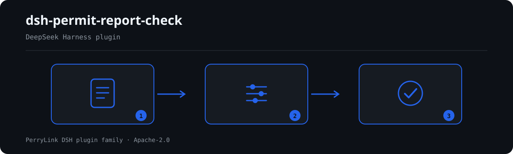

# dsh-permit-report-check — Administrative licensing application register completeness and date consistency check

[English](README.md) · [简体中文](README-zh.md) · [Español](README-es.md) · [Português](README-pt.md) · [हिन्दी](README-hi.md)

[](https://dsh.market/)
[](https://dshfind.com/en/plugins/PerryLink/dsh-permit-report-check?ref=badge)

`dsh-permit-report-check` reads one 行政许可办理台账 — the applicant header plus one row per application item — and checks that register's own closed loop and internal consistency: that each item listed in the 申请材料 column records whether it was submitted, that 受理日期 does not fall after 决定日期, that 决定日期 falls between 受理日期 and the 承诺办结日 the register itself records, that 决定结果 comes from the vocabulary you configured, that a record whose 决定结果 marks a grant carries its 许可证号, that the header names its 申请人 and 申请事项, and that no 许可事项 is registered twice in the table.

## Install

```sh
dsh plugin --profile <name> add dsh-permit-report-check
dsh --profile <name> --dump-config | grep 'dsh-permit-report-check'
```

## What it looks like



*Workflow overview: document → rule pack → findings. The examples below use the real command surface.*


## What it answers

### Examples

The table below is the example set: the first row is the detailed walkthrough, the remaining rows are short cases.

#### Detailed output

**Tool** `permit_report_check`

**Input**

~~~json
{"applicant":"某某公司","matter":"某某建设项目环评审批","rows":[{"序号":"1","许可事项":"建设项目环境影响评价文件审批","申请材料":"环境影响报告书全本及公众参与说明","已提交材料":""}]}
~~~
 
**Output**

~~~json
{
  "id": "dsh-permit-report-check.PR-001.de09b5a6",
  "ruleId": "PR-001",
  "severity": "warn",
  "locator": {
    "row": 1,
    "field": "requiredItems"
  },
  "found": "第 1 行「requiredItems」为「环境影响报告书全本及公众参与说明」，但缺 submittedItems",
  "expected": "满足该条件的行应同时填写 submittedItems"
}
~~~

*Observed from `dsh-permit-report-check/tests/fixtures/PR-001/PR-001-unsafe.json`*

| You ask | What it answers |
|---|---|
| A row lists materials in 申请材料, but 已提交材料 is blank — is that reported? | Yes. `PR-001` requires a `submittedItems` value on every row whose 申请材料 cell is filled, and reports the row when the submission column is empty. It reads the register's own materials column and checks only whether the submission is recorded: it does not compare that list with the matter's service guide, and does not judge whether the materials submitted are complete or compliant. If no row has a filled 申请材料 cell, the rule reports itself in `skipped`. |
| 受理日期 is later than 决定日期 — will that be caught? | Yes. `PR-002` compares the two dates the register itself carries, `acceptedAt` against `decidedAt`, treats the same day as not later, and reports the row where acceptance follows the decision. It only compares those two dates: it does not judge whether the acceptance was lawful or whether the application should have been accepted. A date it cannot parse is reported as its own finding rather than skipped silently. |
| What happens when the 承诺办结日 column is empty — and is the 法定时限 column checked at all? | `PR-003` reports itself in `skipped`: no day count is built in, because statutory periods are counted in working days, may be extended and may exclude hearing or expert-review time, so the only baseline is the 承诺办结日 (`dueAt`) the register states. No rule reads the 法定时限 (`legalDays`) column. When `dueAt` is filled, the rule checks that 决定日期 falls between 受理日期 and it; a finding means the decision disagrees with the deadline you recorded, never that it was late. |
| I wrote 补正后准予 into 决定结果. Is that accepted? | `PR-004` checks 决定结果 against the vocabulary in its `values` parameter, and that parameter ships empty — so as delivered the rule reports itself in `skipped` instead of judging your wording. Fill `values` with the outcomes your institution records (for example 不予受理) and any value not on that list is reported. The rule checks only whether the value is on the list; it does not judge whether the decision is correct or lawful. |
| A record says 准予 but the 许可证号 column is blank. | `PR-005` reports it: when 决定结果 matches a grant marker — `conditionValues`, by default 准予 / 准予许可 / 通过 / 同意 / 已办结 / 批准 — the record must carry its 许可证号 (`certificateNo`). It checks only that the number is filled in, not whether the certificate is genuine, valid or served. With no row matching a grant marker, the rule reports itself in `skipped`. |
| The same 许可事项 appears in two rows. | `PR-007` reports the later row and names the row it duplicates, because two registrations of one matter make the deadline check ambiguous. It checks uniqueness only, and a hit needs human confirmation: one project applying for several matters may legitimately look the same, so distinguish it in the materials column rather than deleting the row. Differences in whitespace are ignored; with no 许可事项 column the rule reports itself in `skipped`. |

## Standards it follows

| Document | Number | Cited by rules |
|---|---|---|
| 《中华人民共和国行政许可法》 | 现行版本与条号本次未核实 | PR-001, PR-002, PR-005, PR-006, PR-007 |
| 各事项办事指南与承诺时限（本机构配置） | 无统一标准（本条依据为台账写明的承诺办结日）—— ⚠️ 法定上限见《行政许可法》第四十二条，本条不引用该条 | PR-003 |
| 本机构许可办理管理口径（本机构配置） | 无统一标准（本条依据为本机构配置的结果口径）—— ⚠️ 法定决定类型见《行政许可法》第三十八条，本条不引用该条 | PR-004 |

**Boundary:** this plugin checks an **行政许可办理台账** for the closed loop a register can be held to — that each
application item records its submission, that acceptance does not follow the decision, that the decision falls
between acceptance and the promised completion date, that the decision outcome comes from your vocabulary, that a
grant records its certificate number, that the register names its applicant and matter, and that matters are not
double-registered. It does **not** decide whether a permit decision was lawful, whether the materials were
complete or compliant, whether an application should be accepted, or whether a permit should be granted.

> ### ⚠️ What this plugin deliberately does not judge
>
> **It does not check whether the materials list is complete.** It reads the register's **own** 申请材料 column
> and checks that each listed item records whether it was submitted — **not** whether that list matches the
> matter's service guide. Verifying the list means comparing it against the guide, which this plugin does not do.
>
> **No statutory period is built in — and the statute says why that is the right call.**
> 《中华人民共和国行政许可法》was read verbatim (see `rules/evidence/clause-verification.md`), and three of its
> provisions make a built-in number unusable: **article 82 requires statutory periods to be counted in working
> days, excluding public holidays**; article 42 sets twenty days with a ten-day extension (forty-five plus
> fifteen for joint handling); and article 45 excludes time needed for hearings, testing, inspection and expert
> review from the period altogether. A register normally records calendar dates, so `PR-003` compares the decision
> date against the **promised completion date written in the register**, and reports itself in `skipped` when that
> column is empty. A finding means "this disagrees with the deadline you recorded", never "this was late".
>
> ⚠️ **The text read was the 2003 promulgation**; a 2019 amendment exists and **was not obtained**, so the pack
> keeps the note 「现行版本与条号本次未核实」 on every rule and claims no article is current law.
>
> **The outcome vocabulary ships empty.** Wording for grants, refusals and terminations varies by institution
> and matter, so `PR-004` reports itself in `skipped` until you configure it, and `PR-005` (which requires a
> certificate number once a grant is recorded) uses a configurable set of grant marker values rather than a
> built-in list.
>
> **Every `excerpt` in the rule pack says, in so many words, that the clause text was not obtained.** The
> regime lives in 《中华人民共和国行政许可法》 and in each matter's service guide. The verification pass could
> not retrieve verbatim clause text, so the pack states the gap in the `excerpt` field itself and keeps every
> rule at `warn` or `info`. **When the texts are in hand, replace each `excerpt` with the real clause and
> raise `kind` to `direct`.**

## Compatibility

| Surface | Status |
|---|---|
| Harness | Peer range `>=0.1.2-rc.1 <0.2.0 \|\| >=0.2.0-0 <0.3.0` — verified to accept both `0.2.0-rc.2` and `0.2.1-rc.2`. `engines.dsh` is declared as `>=0.2.1-0 <0.3.0` and is enforced by the host since 0.2.1 |
| Node | `^22.19.0 || >=24.0.0` |
| Platforms | All (plain ESM; no native code, no network, no model call) |
| Tool mode | Works in `native` and `ptc`; for a caseload use `ptc` |

## What it does

Registers the `permit_report_check` tool. It reads one permit register — the applicant header plus one row per
application item — applies a versioned rule pack, and returns a report.

| Rule | Check | Severity | Basis kind |
|---|---|---|---|
| `PR-001` | each listed material records its submission | warn | principle |
| `PR-002` | acceptance does not follow the decision | warn | principle |
| `PR-003` | the decision falls between acceptance and the promised date | info | local |
| `PR-004` | the outcome comes from your vocabulary (off by default) | info | local |
| `PR-005` | a grant records its certificate number | warn | principle |
| `PR-006` | the register names its applicant and matter | warn | principle |
| `PR-007` | matters are not double-registered | warn | principle |

## Configuration

| Key | Type | Default | Description |
|---|---|---|---|
| `rulesFile` | string | `rules/permit-report-check.yaml` | Rule-pack path, relative to the package root |
| `disabledRules` | string[] | `[]` | Rule ids to stop running; each appears in `skipped` |
| `onlyRules` | string[] | `[]` | Run only these rule ids; empty runs every rule |
| `skipNotes` | string | `""` | Note appended to every `skipped` reason |
| `timeoutMs` | number | `120000` | Cooperative tool timeout budget |

Rule-level parameters worth knowing:

- `PR-003` needs the register's 承诺办结日 / `dueAt` column. The plugin never derives a deadline from a day
  count; statutory periods differ by matter and may be extended.
- `PR-004` `values` — your outcome vocabulary, e.g. `[准予, 不予, 不予受理, 终止, 补正后准予]`. Empty means no
  check.
- `PR-005` `conditionValues` — the values that mark a grant, by default
  `[准予, 准予许可, 通过, 同意, 已办结, 批准]`.
- `PR-001` `conditionField` / `requiredFields` — which column triggers the requirement; the materials column,
  requiring the submission column.

## Material format

The tool accepts JSON or YAML:

```yaml
applicant: 某某公司
matter: 某某建设项目环评审批
window: 综合受理窗口
rows:
  - { 序号: '1', 许可事项: 建设项目环境影响评价文件审批, 许可机关: 某某生态环境局,
      法定依据: 《中华人民共和国环境影响评价法》第二十二条,
      申请材料: 环境影响报告书全本及公众参与说明,
      已提交材料: 已提交报告书全本（含公众参与说明），受理编号 SL-2026-018,
      受理日期: 2026-03-02, 法定时限: '60', 承诺办结日: 2026-04-30,
      决定日期: 2026-04-20, 决定结果: 准予, 许可证号: 某环审〔2026〕18 号, 承办人: 王工 }
```

Column names are matched case-insensitively and ignoring spaces, underscores and hyphens; the register's own
column names are kept, so a finding names the column it read.

## Rule sources

Rule data lives in `rules/permit-report-check.yaml`. The pack's header states the citation gap in full, and
each rule's `note` repeats the part that matters for that rule. The load-time guard that normally enforces "an
excerpt must be a real quotation of at least eight characters" cannot tell a quotation from a description —
so this pack leans on the header, the per-rule notes and a test that asserts every `excerpt` admits the gap.

## Troubleshooting

- **`PR-003` reports itself as skipped.** The register records no promised completion date. Statutory periods
  differ by matter and may be extended, so the plugin will not supply one.
- **`PR-003` fires but I consider the handling timely.** The recorded promised date disagrees with the decision
  date. Either the deadline was worked out wrongly or the decision date is wrong.
- **`PR-001` did not catch a missing material.** It checks the register's own list, not the service guide's.
  Whether the list is complete is a comparison this plugin does not make.
- **`PR-004` never runs.** Its vocabulary is empty; fill it with the outcomes your institution records.
- **`PR-005` fires on a grant with no certificate number.** Either the certificate was not issued yet or the
  column was left blank. Narrow `conditionValues` if your register uses a different grant wording.
- **The plugin installs but the tool never appears.** Check that `main` resolves to `lib/index.mjs` and
  that `pnpm run build` produced it; a wrong `main` makes the loader skip the entry silently.
- **`dsh plugin add` refuses the package as incompatible.** The peer range covers `0.1.x` and `0.2.x`; if
  your runtime sits outside it, grant an explicit exemption:
  `dsh plugin --profile <name> allow-version dsh-permit-report-check@0.1.0 --dsh-version <runtime> --accept-risk`
- **`check` reports `manifest-peers` as failed.** The static checker compares against a hard-coded peer
  range that predates the 0.2 line. The runtime enforces peer compatibility at install time, so the
  declared range is the correct one; this is a known upstream issue in `dsh-plugin-dev`.

## Development

```sh
pnpm install
pnpm run typecheck   # tsc --noEmit
pnpm test            # vitest, the shared table-plugin suite plus paired fixtures
pnpm run build       # tsdown -> lib/index.mjs + lib/index.d.mts
node ../scripts/sync-shared.mjs dsh-permit-report-check   # refresh src/shared from ../_shared
```

The plugin is **data-only**: `src/model.ts` declares the table shape, the shared kit supplies the reader and
the check engine, and the rule pack declares every check.

## PerryLink DSH Plugin Family

This project is part of the DeepSeek Harness plugin family from [PerryLink](https://github.com/PerryLink). The roster stays collapsed below so every README keeps a short first screen; expand it to see every row and its status.

<details>
<summary>Expand all plugins</summary>

| Plugin | Status |
|---|---|
| **[dsh-aqua-input-check](https://github.com/PerryLink/dsh-aqua-input-check)** |  |
| **[dsh-archive-check](https://github.com/PerryLink/dsh-archive-check)** |  |
| **[dsh-auto-review](https://github.com/PerryLink/dsh-auto-review)** |  |
| **[dsh-autotier](https://github.com/PerryLink/dsh-autotier)** |  |
| **[dsh-bid-ca-precheck](https://github.com/PerryLink/dsh-bid-ca-precheck)** |  |
| **[dsh-bid-qual-check](https://github.com/PerryLink/dsh-bid-qual-check)** |  |
| **[dsh-cert-mcp](https://github.com/PerryLink/dsh-cert-mcp)** |  |
| **[dsh-checkpoint-rewind](https://github.com/PerryLink/dsh-checkpoint-rewind)** |  |
| **[dsh-click](https://github.com/PerryLink/dsh-click)** |  |
| **[dsh-composer-history](https://github.com/PerryLink/dsh-composer-history)** |  |
| **[dsh-contract-stance](https://github.com/PerryLink/dsh-contract-stance)** |  |
| **[dsh-customs-doc-check](https://github.com/PerryLink/dsh-customs-doc-check)** |  |
| **[dsh-data-quality](https://github.com/PerryLink/dsh-data-quality)** |  |
| **[dsh-demurrage-ledger](https://github.com/PerryLink/dsh-demurrage-ledger)** |  |
| **[dsh-doublecheck](https://github.com/PerryLink/dsh-doublecheck)** |  |
| **[dsh-drill-script-check](https://github.com/PerryLink/dsh-drill-script-check)** |  |
| **[dsh-eia-guide-check](https://github.com/PerryLink/dsh-eia-guide-check)** |  |
| **[dsh-emergency-plan](https://github.com/PerryLink/dsh-emergency-plan)** |  |
| **[dsh-essay-rubric-check](https://github.com/PerryLink/dsh-essay-rubric-check)** |  |
| **[dsh-evidence-check](https://github.com/PerryLink/dsh-evidence-check)** |  |
| **[dsh-export-ctl-check](https://github.com/PerryLink/dsh-export-ctl-check)** |  |
| **[dsh-fast](https://github.com/PerryLink/dsh-fast)** |  |
| **[dsh-fmea-table-check](https://github.com/PerryLink/dsh-fmea-table-check)** |  |
| **[dsh-forecast-penalty](https://github.com/PerryLink/dsh-forecast-penalty)** |  |
| **[dsh-fund-research](https://github.com/PerryLink/dsh-fund-research)** |  |
| **[dsh-github](https://github.com/PerryLink/dsh-github)** |  |
| **[dsh-gongwen-flow-check](https://github.com/PerryLink/dsh-gongwen-flow-check)** |  |
| **[dsh-gongwen-word-check](https://github.com/PerryLink/dsh-gongwen-word-check)** |  |
| **[dsh-guard-plan-qc](https://github.com/PerryLink/dsh-guard-plan-qc)** |  |
| **[dsh-hazchem-check](https://github.com/PerryLink/dsh-hazchem-check)** |  |
| **[dsh-hazplan-check](https://github.com/PerryLink/dsh-hazplan-check)** |  |
| **[dsh-hidden-risk-map](https://github.com/PerryLink/dsh-hidden-risk-map)** |  |
| **[dsh-hs-classify](https://github.com/PerryLink/dsh-hs-classify)** |  |
| **[dsh-icd-rule-check](https://github.com/PerryLink/dsh-icd-rule-check)** |  |
| **[dsh-industry-research](https://github.com/PerryLink/dsh-industry-research)** |  |
| **[dsh-lawcite-adapter](https://github.com/PerryLink/dsh-lawcite-adapter)** |  |
| **[dsh-laya](https://github.com/PerryLink/dsh-laya)** |  |
| **[dsh-lc-doc-check](https://github.com/PerryLink/dsh-lc-doc-check)** |  |
| **[dsh-learning-gap-check](https://github.com/PerryLink/dsh-learning-gap-check)** |  |
| **[dsh-library](https://github.com/PerryLink/dsh-library)** |  |
| **[dsh-local-ai](https://github.com/PerryLink/dsh-local-ai)** |  |
| **[dsh-lsp-actions](https://github.com/PerryLink/dsh-lsp-actions)** |  |
| **[dsh-mask](https://github.com/PerryLink/dsh-mask)** |  |
| **[dsh-mcp-panel](https://github.com/PerryLink/dsh-mcp-panel)** |  |
| **[dsh-medrec-qc](https://github.com/PerryLink/dsh-medrec-qc)** |  |
| **[dsh-memento](https://github.com/PerryLink/dsh-memento)** |  |
| **[dsh-nsfc-form-check](https://github.com/PerryLink/dsh-nsfc-form-check)** |  |
| **[dsh-nurse-record-check](https://github.com/PerryLink/dsh-nurse-record-check)** |  |
| **[dsh-observe](https://github.com/PerryLink/dsh-observe)** |  |
| **[dsh-origin-rvc-check](https://github.com/PerryLink/dsh-origin-rvc-check)** |  |
| **[dsh-ota-review-check](https://github.com/PerryLink/dsh-ota-review-check)** |  |
| **[dsh-output-styles](https://github.com/PerryLink/dsh-output-styles)** |  |
| **[dsh-paper-doc-adapter](https://github.com/PerryLink/dsh-paper-doc-adapter)** |  |
| **[dsh-permission-rules](https://github.com/PerryLink/dsh-permission-rules)** |  |
| **[dsh-permit-report-check](https://github.com/PerryLink/dsh-permit-report-check)** |  |
| **[dsh-pipeline-check](https://github.com/PerryLink/dsh-pipeline-check)** |  |
| **[dsh-pleading-draft](https://github.com/PerryLink/dsh-pleading-draft)** |  |
| **[dsh-plugin-doctor](https://github.com/PerryLink/dsh-plugin-doctor)** |  |
| **[dsh-plugin-guide](https://github.com/PerryLink/dsh-plugin-guide)** |  |
| **[dsh-plugin-kit](https://github.com/PerryLink/dsh-plugin-kit)** |  |
| **[dsh-plugin-upgrade](https://github.com/PerryLink/dsh-plugin-upgrade)** |  |
| **[dsh-policy-brief-draft](https://github.com/PerryLink/dsh-policy-brief-draft)** |  |
| **[dsh-power-loss-split](https://github.com/PerryLink/dsh-power-loss-split)** |  |
| **[dsh-power-ticket-check](https://github.com/PerryLink/dsh-power-ticket-check)** |  |
| **[dsh-ppap-check](https://github.com/PerryLink/dsh-ppap-check)** |  |
| **[dsh-protest-deadline](https://github.com/PerryLink/dsh-protest-deadline)** |  |
| **[dsh-railway-window](https://github.com/PerryLink/dsh-railway-window)** |  |
| **[dsh-repair-order-qc](https://github.com/PerryLink/dsh-repair-order-qc)** |  |
| **[dsh-research-report](https://github.com/PerryLink/dsh-research-report)** |  |
| **[dsh-review-reply-check](https://github.com/PerryLink/dsh-review-reply-check)** |  |
| **[dsh-rulefile-check](https://github.com/PerryLink/dsh-rulefile-check)** |  |
| **[dsh-safety-brief-check](https://github.com/PerryLink/dsh-safety-brief-check)** |  |
| **[dsh-score](https://github.com/PerryLink/dsh-score)** |  |
| **[dsh-session-sync](https://github.com/PerryLink/dsh-session-sync)** |  |
| **[dsh-site-log-check](https://github.com/PerryLink/dsh-site-log-check)** |  |
| **[dsh-skill-pack-security](https://github.com/PerryLink/dsh-skill-pack-security)** |  |
| **[dsh-soe-decision-check](https://github.com/PerryLink/dsh-soe-decision-check)** |  |
| **[dsh-soilwater-check](https://github.com/PerryLink/dsh-soilwater-check)** |  |
| **[dsh-sop-sync-check](https://github.com/PerryLink/dsh-sop-sync-check)** |  |
| **[dsh-spc-gbt-adapter](https://github.com/PerryLink/dsh-spc-gbt-adapter)** |  |
| **[dsh-talk](https://github.com/PerryLink/dsh-talk)** |  |
| **[dsh-tender-extract](https://github.com/PerryLink/dsh-tender-extract)** |  |
| **[dsh-tender-matrix](https://github.com/PerryLink/dsh-tender-matrix)** |  |
| **[dsh-test-drive](https://github.com/PerryLink/dsh-test-drive)** |  |
| **[dsh-ticktick](https://github.com/PerryLink/dsh-ticktick)** |  |
| **[dsh-translate](https://github.com/PerryLink/dsh-translate)** |  |
| **[dsh-warranty-calc](https://github.com/PerryLink/dsh-warranty-calc)** |  |
| **[dsh-budget](https://github.com/PerryLink/dsh-budget)** | 🧊 FROZEN — see the repo README |
| **[dsh-claude-move](https://github.com/PerryLink/dsh-claude-move)** | 🧊 FROZEN — see the repo README |
| **[dsh-defend](https://github.com/PerryLink/dsh-defend)** | 🧊 FROZEN — see the repo README |
| **[dsh-draw](https://github.com/PerryLink/dsh-draw)** | 🧊 FROZEN — see the repo README |
| **[dsh-reach](https://github.com/PerryLink/dsh-reach)** | 🧊 FROZEN — see the repo README |
| **[dsh-background-agents](https://github.com/PerryLink/dsh-background-agents)** | 🚫 RETIRED — see the repo README |
| **[dsh-session-pin](https://github.com/PerryLink/dsh-session-pin)** | 🚫 RETIRED — see the repo README |
| **[dsh-team-rooms](https://github.com/PerryLink/dsh-team-rooms)** | 🚫 RETIRED — see the repo README |

</details>

## License

[Apache License 2.0](LICENSE) © 2026 dsh-permit-report-check contributors.
