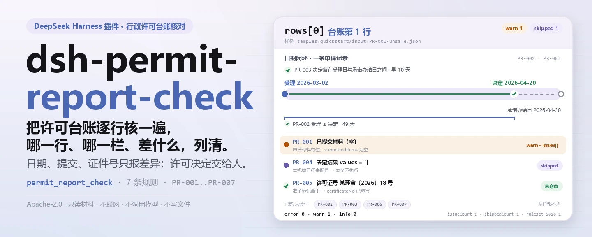
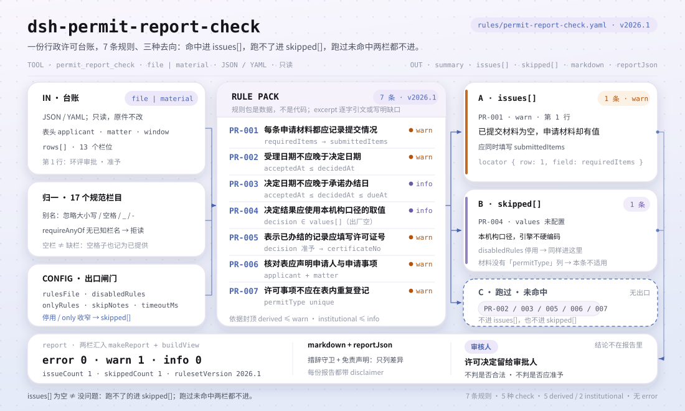

<div align="center">

<picture>
  <source media="(prefers-color-scheme: dark)" srcset="docs/assets/dsh-permit-report-check-hero-zh-dark.webp">
  
</picture>

# dsh-permit-report-check

**把行政许可办理台账逐行核一遍——输出「哪一行、哪一栏、差什么」的清单，许可决定留给审批人。**

面向 DeepSeek Harness 的数据型核查插件：读取一份行政许可办理台账（申请人表头加每条申请一行），按随包的版本化规则包（PR-001..PR-007）核对台账自身的闭环与自洽，只列逐条可指认的差异，不判合规、不认定责任。

[安装](#三步上手) · [配置](#配置) · [FAQ](#faq) · [简体中文](README.md) · [English](README.en.md) · [Español](README.es.md) · [Português](README.pt.md) · [हिन्दी](README.hi.md)

[](LICENSE)
[](#兼容性)
[](https://www.npmjs.com/package/dsh-permit-report-check)
[](https://github.com/PerryLink/dsh-permit-report-check/actions/workflows/ci.yml)
[](#兼容性)

[](https://github.com/PerryLink/dsh-permit-report-check/stargazers)
[](https://www.npmjs.com/package/dsh-permit-report-check)
[](https://dshfind.com/plugins/PerryLink/dsh-permit-report-check?ref=badge)
[](https://securityscorecards.dev/viewer/?uri=github.com/PerryLink/dsh-permit-report-check)
[](https://dsh.market/)
[](https://gitee.com/perrylink/dsh-permit-report-check)

```sh
dsh plugin --profile <name> add dsh-permit-report-check
```

</div>

<sub>社区插件，与 DeepSeek 官方无关。唯一仓库：<https://github.com/PerryLink/dsh-permit-report-check>（Gitee 为镜像）。</sub>

## 它是什么

`dsh-permit-report-check` 读取一份行政许可办理台账——申请人表头，加每条申请一行——核对这份台账自身的闭环与自洽：申请材料栏列出的每一项是否记录了提交情况、受理日期是否不晚于决定日期、决定日期是否落在受理日期与该台账自己写的承诺办结日之间、决定结果是否取自你配置的取值口径、决定结果表示已办结的记录是否填写了许可证号、表头是否声明了申请人与申请事项、许可事项是否在表内重复登记。

- **给谁用**：行政审批窗口、合规岗；不用懂命令行，在对话里把材料交给它即可。
- **你交什么**：这项核对用到的原始材料（表格、清单或文书）；不改原件。Excel 可先转成 JSON/YAML，对话里也能代转。
- **它交什么**：一份「哪一行、哪一栏、差什么」的清单；没能执行的检查逐条列入 `skipped` 并写明原因。
- **它不做什么**：不判合规、不认定责任、不替代审核人；只列材料内部能逐条指认的差异。

<picture>
  <source media="(prefers-color-scheme: dark)" srcset="docs/assets/dsh-permit-report-check-flow-v5-dark.svg">
  
</picture>

## 三步上手

1. **安装**（三选一）：

   ```sh
   # git 通道（最新 main；等价于 git+https://github.com/PerryLink/dsh-permit-report-check.git）
   dsh plugin --profile <name> add github:PerryLink/dsh-permit-report-check
   # npm 通道（已发布版本）
   dsh plugin --profile <name> add dsh-permit-report-check
   # tarball 通道：本仓库 pnpm pack 后
   dsh plugin --profile <name> add ./dsh-permit-report-check-<version>.tgz
   ```

2. **最小配置**（默认即可用；bundle 行不带 `config` 时全部走默认值，规则包路径指向随包的 `rules/permit-report-check.yaml`）：

   ```yaml
   - insert:
       - id: dsh-permit-report-check
         name: dsh-permit-report-check
   ```

3. **验证已生效**：

   ```sh
   dsh --profile <name> --dump-config | grep 'dsh-permit-report-check'
   ```

   然后用仓内自带样例跑一次（需先 `pnpm run build` 产出 `lib/`）：

   ```sh
   node samples/quickstart/run.mjs
   ```

   输出（对应 `samples/quickstart/expected/result.json`）：

   ```text
   permit_report_check: 1 issue(s) — error 0, warn 1, info 0
   skipped: 1
   ```

   截图见 `docs/assets/quickstart.png`。

**卸载**：`dsh plugin --profile <name> remove dsh-permit-report-check`（或从 profile patch 删掉该行）。

<details>
<summary>在 WorkBuddy / 扣子中使用</summary>

在 WorkBuddy / 扣子搜「职业文档核对全集」（总包，本检查是其中一项；上架以商城为准）即可调用同一套核对能力，无需命令行。

</details>

<details>
<summary>从 DSH Desktop 市场安装</summary>

所有 PerryLink 插件均可在 DSH Desktop 内置市场中浏览：**市场 → 来源 → 添加来源 → 粘贴** `https://perrylink-dsh-catalog.perrylink.workers.dev/catalog-source.json` **→ 选中**。安装仍需通过市场的 npm 身份校验与你的确认。

</details>

## 核心能力

`dsh-permit-report-check` 注册 `permit_report_check` 工具：读入一份行政许可办理台账（申请人表头加每条申请一行），套用版本化规则包，返回一份报告。

- **七条规则一包带走** —— 规则包是数据不是代码（`rules/permit-report-check.yaml`）；换掉规则包即换掉整套检查，不动一行 TypeScript。
- **只读材料** —— 接受 JSON 或 YAML，原件永不修改；纯 ESM，无网络请求、不调用模型。
- **引文不造假** —— 每条规则带 `document` / `number` / `clause` / `excerpt` / `kind` / `source`；`excerpt` 必须是逐字引文，本次未取得原文的规则在 `excerpt` 里如实写明并标为 `derived-from-principle`。
- **严重级跟着证据走** —— `derived-from-principle` 最高 `warn`，本机构配置（`institutional-configuration`）最高 `info`，并有测试断言。
- **空清单 ≠ 没问题** —— 每条没能执行的检查都进 `skipped` 并写明原因；必填清单未配置的规则自我报告 `skipped`，绝不静默通过。
- **措辞不作裁决** —— 报告只列差异，不判定合规、责任或正确性；措辞守卫（wording guard）强制执行，报告永远附带免责声明。

| 规则 | 核对内容 | 严重级 | 依据类别 |
|---|---|---|---|
| `PR-001` | 每条申请材料都应记录提交情况 | warn | principle |
| `PR-002` | 受理日期不应晚于决定日期 | warn | principle |
| `PR-003` | 决定日期不应晚于承诺办结日 | info | local |
| `PR-004` | 决定结果应使用本机构口径的取值（出厂关闭） | info | local |
| `PR-005` | 表示已办结的记录应填写许可证号 | warn | principle |
| `PR-006` | 核对表应声明申请人与申请事项 | warn | principle |
| `PR-007` | 许可事项不应在表内重复登记 | warn | principle |

### 工具面

`permit_report_check` 只有四个入参，且全程只读：

| 参数 | 类型 | 说明 |
|---|---|---|
| `file` | string | 材料文件的绝对路径（JSON 或 YAML），与 `material` 二选一 |
| `material` | string | 内联材料文本（JSON 或 YAML），与 `file` 二选一 |
| `rulesFile` | string | 覆盖配置里的规则库路径（相对插件包根或绝对路径） |
| `only` | string[] | 只执行这些规则 id；留空时沿用配置的 `onlyRules` |

### 示例

以下为插件真实入口；安装后调用一次即可。第一行是详细走查，其余是简短案例。

**详细示例** — 工具 `permit_report_check`，输入：

```json
{"applicant":"某某公司","matter":"某某建设项目环评审批","rows":[{"序号":"1","许可事项":"建设项目环境影响评价文件审批","申请材料":"环境影响报告书全本及公众参与说明","已提交材料":""}]}
```

输出：

```json
{
  "id": "dsh-permit-report-check.PR-001.de09b5a6",
  "ruleId": "PR-001",
  "severity": "warn",
  "locator": {
    "row": 1,
    "field": "requiredItems"
  },
  "found": "第 1 行「requiredItems」为「环境影响报告书全本及公众参与说明」，但缺 submittedItems",
  "expected": "满足该条件的行应同时填写 submittedItems"
}
```

*Observed from `dsh-permit-report-check/tests/fixtures/PR-001/PR-001-unsafe.json`*

本插件对自己 `PR-001` 测试夹具的真实输出，不是示意图。规则库不伪造引文，因此每条发现都会同时写明所引条款，以及该条款原文本次未取得。

| 你会问 | 它怎么答 |
|---|---|
| 某行的申请材料栏列了材料，已提交材料栏却空着，会被报出吗？ | 会。`PR-001` 要求凡申请材料栏填了内容的行都必须填写 `submittedItems`，提交情况栏为空即报出该行。它读的是台账自己列的申请材料栏，只核对是否记录了提交情况：不拿这份清单与该事项的办事指南比对，也不判断已提交的材料是否齐全、是否符合要求。若没有任何一行填了申请材料，本条进入 `skipped`，而不是静默通过。 |
| 受理日期晚于决定日期，能查出来吗？ | 能。`PR-002` 拿台账自己写的两个日期相比（`acceptedAt` 与 `decidedAt`），同一天视为不晚于，受理晚于决定时逐行报出。它只比较这两个日期：不判断受理是否合法、是否应当受理。解析不了的日期会单独报出，不会静默跳过。 |
| 承诺办结日这一栏是空的会怎样？法定时限那一栏又有没有规则在读？ | `PR-003` 会进入 `skipped`：本插件不内置任何期限天数——法定期限按工作日计算，可依法延长，听证、专家评审等所需时间还可能不计入，唯一可靠的基准就是台账自己写的承诺办结日（`dueAt`）。没有任何规则读法定时限（`legalDays`）栏。`dueAt` 填写后，本条核对决定日期是否落在受理日期与该日之间；命中只表示「与你写在台账里的期限不一致」，不表示已经超期。 |
| 决定结果我填了「补正后准予」，会被接受吗？ | `PR-004` 拿决定结果与你配置的 `values` 取值清单比对，而该清单出厂为空——因此按出厂配置，本条进入 `skipped`，而不是评判你的写法。把本机构实际记录的结果填进 `values`（例如「不予受理」）后，凡不在册的取值都会被报出。本条只核对取值是否在册，不判断该决定是否正确、是否合法。 |
| 某条记录写的是「准予」，许可证号栏却空着。 | `PR-005` 会报出：当决定结果命中准予标记（`conditionValues`，默认为 准予 / 准予许可 / 通过 / 同意 / 已办结 / 批准）时，该记录必须填写许可证号（`certificateNo`）。它只核对证件号是否填写，不判断该证件是否真实有效、是否已送达。台账里没有任何一行命中准予标记时，本条进入 `skipped`。 |
| 同一个许可事项出现在两行里。 | `PR-007` 会报出后出现的那一行，并指出它与哪一行重复，因为同一事项登记两次会让时限核对无从判断。它只核对唯一性，且命中需要人工确认：一个项目同时申请多个事项时，事项名称相同是可能的，此时应在材料名称栏加以区分，而不是简单删除该行。值内部的空白差异会被忽略；台账没有许可事项栏时，本条进入 `skipped`。 |

## 依据的标准

| 文件 | 文号 | 引用它的规则 |
|---|---|---|
| 《中华人民共和国行政许可法》 | 现行版本与条号本次未核实 | PR-001, PR-002, PR-005, PR-006, PR-007 |
| 各事项办事指南与承诺时限（本机构配置） | 无统一标准（本条依据为台账写明的承诺办结日）—— ⚠️ 法定上限见《行政许可法》第四十二条，本条不引用该条 | PR-003 |
| 本机构许可办理管理口径（本机构配置） | 无统一标准（本条依据为本机构配置的结果口径）—— ⚠️ 法定决定类型见《行政许可法》第三十八条，本条不引用该条 | PR-004 |

**边界：** 本插件核对一份 **行政许可办理台账** 在台账层面可以要求到的闭环——每项申请材料是否记录了提交情况，受理是否不晚于决定，决定是否落在受理日期与承诺办结日之间，决定结果是否取自你的取值口径，准予是否记录了许可证号，台账是否写明申请人与申请事项，以及许可事项是否未被重复登记。它**不**判定许可决定是否合法、材料是否齐全或合规、申请是否应当受理，或许可是否应当准予。

> ### ⚠️ 这个插件刻意不作判断的事
>
> **它不核对材料清单是否完整。** 它读取台账**自身**的 申请材料 列，核对其中每个列出的材料项是否记录了提交情况——**而不是**核对该清单是否与该事项的办事指南一致。核验清单意味着将其与办事指南比对，而本插件不做这件事。
>
> **不内置任何法定期限——而法律本身说明了为什么这是正确的做法。** 《中华人民共和国行政许可法》已逐字阅读（见 `rules/evidence/clause-verification.md`），其中有三项规定使内置数字无法使用：**第八十二条要求法定期限按工作日计算，不含法定节假日**；第四十二条规定二十日、可延长十日（联合办理为四十五日加十五日）；第四十五条则把听证、检测、检验和专家评审所需时间完全排除在期限之外。台账通常记录日历日期，因此 `PR-003` 把决定日期与**台账中写明的承诺办结日期**相比，并在该列为空时把自己记入 `skipped`。一项发现的意思是「这与你所记录的截止日期不一致」，而绝不是「这已经逾期」。
>
> ⚠️ **本次阅读的文本是 2003 年公布版本**；2019 年存在一次修正，但**本次未取得**，因此规则库在每条规则上都保留了「现行版本与条号本次未核实」的说明，也不声称任何条款属于现行法律。
>
> **结果词表出厂为空。** 准予、不予和终止的措辞因机构和事项而异，因此 `PR-004` 在你配置之前会把自己记入 `skipped`；而 `PR-005`（一旦记录了准予，就要求填写许可证号）使用一组可配置的准予标记值，而不是内置清单。
>
> **规则库中的每一个 `excerpt` 都明文写着：条款原文本次未取得。** 该制度见于《中华人民共和国行政许可法》以及每个事项的办事指南。核验环节无法取得逐字条款原文，因此规则库在 `excerpt` 字段本身写明这一缺口，并把每条规则保持在 `warn` 或 `info`。**待取得原文后，请把每个 `excerpt` 换成真实条款，并把 `kind` 提到 `direct`。**

## 配置

全部可调参数都是 `src/config.ts` 里的 Schemastery `Config` 字段（可从 cordis.yml 覆盖），逐条阈值在 `rules/` 下的规则库文件里。按 id 覆盖会替换整行——请重述所有需要的键。

| 键 | 类型 | 默认值 | 说明 |
|---|---|---|---|
| `rulesFile` | string | `rules/permit-report-check.yaml` | 规则库文件路径，相对插件包根目录 |
| `disabledRules` | string[] | `[]` | 要停用的规则 id 列表；每条都会出现在 `skipped` 中 |
| `onlyRules` | string[] | `[]` | 只执行这些规则 id；留空表示执行全部规则 |
| `skipNotes` | string | `""` | 附加到每条 `skipped` 说明后的备注 |
| `timeoutMs` | number | `120000` | 工具协作式超时预算（毫秒） |

值得了解的规则级参数：

- `PR-001` `conditionField` / `requiredFields` —— 哪一栏触发要求：申请材料栏有值，则要求提交情况栏有值。
- `PR-003` `notAfterField` —— 与 `dueAt`（承诺办结日）比对；本插件从不按天数推算期限。
- `PR-004` `values` —— 你的决定结果词表，例如 `[准予, 不予, 不予受理, 终止, 补正后准予]`；出厂为空表示不核对。
- `PR-005` `conditionValues` —— 标记「已准予」的取值，出厂默认为 `[准予, 准予许可, 通过, 同意, 已办结, 批准]`。
- `PR-006` `fields` —— 必须出现在表头的字段，默认 `[applicant, matter]`；表头还记窗口时可把 `window` 加进来。
- `PR-007` `field` —— 要求表内唯一的那一栏，默认许可事项栏（`permitType`）。

profile patch 覆盖示例：

```yaml
- insert:
    - id: dsh-permit-report-check
      name: dsh-permit-report-check
      config:
        disabledRules: [PR-004]
        timeoutMs: 180000
```

## 材料格式

工具接受 JSON 或 YAML：

```yaml
applicant: 某某公司
matter: 某某建设项目环评审批
window: 综合受理窗口
rows:
  - { 序号: '1', 许可事项: 建设项目环境影响评价文件审批, 许可机关: 某某生态环境局,
      法定依据: 《中华人民共和国环境影响评价法》第二十二条,
      申请材料: 环境影响报告书全本及公众参与说明,
      已提交材料: 已提交报告书全本（含公众参与说明），受理编号 SL-2026-018,
      受理日期: 2026-03-02, 法定时限: '60', 承诺办结日: 2026-04-30,
      决定日期: 2026-04-20, 决定结果: 准予, 许可证号: 某环审〔2026〕18 号, 承办人: 王工 }
```

列名匹配忽略大小写，并忽略空格、下划线与连字符；台账自己的列名会被保留，因此发现里写明的列就是它实际读到的列。字段在读取层是可选的，由检查引擎校验，因此部分导出的材料会产生「缺项」类差异，而不是让程序崩溃。

## 规则来源

规则数据在 `rules/permit-report-check.yaml`，与代码分离：每条规则都带文件名、文号、按原文自身编号体系的条款号、逐字摘录与来源地址。规则包头部完整写明本次引文缺口，每条规则的 `note` 复述与该条相关的部分。加载期守卫通常强制「摘录必须是不少于八个字符的真实引文」，但它分不清引文与描述——因此本规则包依靠头部声明、逐条 `note`，以及一条断言所有 `excerpt` 都承认缺口的测试来兜底。夸大依据的规则库会在加载期失败，而不会产出一份看起来很有底气的报告。核验中确认的边界与「刻意没有作出的结论」随包收录在 `rules/evidence/` 目录。

## FAQ

<details>
<summary>它会替我们下「准予 / 不予」的结论吗？</summary>

不会。它只列出材料内部能逐条指认的差异（哪一行、哪一栏、差什么），不作事实判断，也不评价合法性——许可决定永远留给审批人。报告措辞由措辞守卫强制约束，且每份报告都带免责声明。

</details>

<details>
<summary>台账是 Excel，能直接用吗？</summary>

可以，先转成 JSON 或 YAML；平台支持时在对话里就能代为转换。工具只读材料，永不修改原件。

</details>

<details>
<summary>为什么不内置法定期限的条文天数？</summary>

因为《行政许可法》本身让内置数字无法使用：第八十二条要求期限按工作日计算（不含法定节假日），第四十二条的二十日可延长十日（统一、联合或集中办理为四十五日加十五日），第四十五条还把听证、检验、检测、鉴定、专家评审的时间排除在期限之外。台账通常只记自然日，因此 `PR-003` 只与台账自己写的承诺办结日（`dueAt`）比对；该栏为空时本条进 `skipped`，绝不替你假定一个期限。

</details>

<details>
<summary>`issues` 为空能当作「没问题」吗？</summary>

不能。每条没能执行的检查都列在 `skipped` 里并写明原因（例如承诺办结日为空、`values` 未配置、规则被停用）。判读报告时请把 `issues` 与 `skipped` 一起看完。

</details>

<details>
<summary>会联网或上传台账吗？性能开销多大？</summary>

不联网、不调用模型、不写任何文件：读取、比对与日期算术都在本机完成，材料只经工具入参传进来。批量核对整季台账或整个目录时建议用 `ptc` 模式，schema 成本只付一次；`timeoutMs`（默认 120000 毫秒）是协作式超时预算。

</details>

## 排障

- **插件装上了但工具不出现**：确认 `main` 指向 `lib/index.mjs` 且 `pnpm run build` 已生成该文件；`main` 写错会让加载器静默跳过该条目。
- **`dsh plugin add` 报版本不兼容**：peer 范围覆盖 `0.1.x` 与 `0.2.x`；若运行时在其之外，可显式豁免：`dsh plugin --profile <name> allow-version dsh-permit-report-check@0.1.0 --dsh-version <runtime> --accept-risk`
- **`check` 报 `manifest-peers` 失败**：静态检查器比对的是一份早于 0.2 世代的硬编码 peer 范围；安装期的 peer 校验以运行时为准，声明的范围才是正确的。这是 `dsh-plugin-dev` 的已知上游问题。
- **某条规则没有执行**：查看 `skipped` 数组，其中写明了规则 id 与原因。
- **装上了却看不到任何发现**：先确认工具确实运行并返回了结果——空结果不等于「跳过执行」；再对照「核心能力」的规则表检查材料列名是否被读到，缺输入通常进 `skipped`，而不是被猜成一条发现。
- **`PR-003` 自我报告为 skipped**：台账没有写承诺办结日。各事项期限不同且可依法延长，插件不会替你补一个。
- **`PR-003` 命中但我认为办理并未超期**：命中的含义是「决定日期与你写在台账里的承诺办结日不一致」——要么期限算错了，要么决定日期写错了。
- **`PR-001` 没有查出缺材料**：它核对的是台账自己列的清单，不是办事指南；清单是否完整属于它不做的那类比对。
- **`PR-004` 从来不运行**：它的取值清单出厂为空；把本机构实际记录的结果填进 `values`。
- **`PR-005` 对一条准予记录报错**：要么许可证还没发，要么该栏忘了填；若本机构用别的准予措辞，收窄 `conditionValues`。
- **发现里说条款原文本次未取得**：规则库有引文闸门，绝不编造条文；原文未取得时发现停在 `warn`/`info` 并在 `excerpt` 里写明。请把它当作核验缺口，而不是「材料合规」的证明。
- **所有发现都只是 `warn` 或 `info`**：按设计如此——本插件不作法律定性，只报差异，由人决定怎么处理。
- **时间看起来偏移**：全部计算都是对输入字符串做墙上时钟运算，不做时区换算。

## 兼容性

| 项目 | 状态 |
|---|---|
| Harness | 对等版本范围 `>=0.1.2-rc.1 <0.2.0 \|\| >=0.2.0-0 <0.3.0` —— 已实测同时接受 `0.2.0-rc.2` 与 `0.2.1-rc.2`。已声明 `engines.dsh`：0.2.1 起由宿主单独裁决，范围为 `>=0.2.1-0 <0.3.0` |
| Node | `^22.19.0 \|\| >=24.0.0` |
| 平台 | 全平台（纯 ESM；无原生代码、无联网、不调用模型） |
| 工具模式 | `native` / `ptc` 均可；批量校验整个目录时建议 `ptc`，schema 成本只付一次 |

**互操作性**：本插件只声明 `tools:register` 一项能力（见 `package.json#dsh.capabilities`），只注册一个带命名空间的工具 `permit_report_check`，不提供 service key、不注册客户端 slot、不注册 `webServer` 前缀；随包 patch 只 `insert` 自己那一行，从不覆写内置行的 `config`。因此它不与其他插件争抢工具名、服务键、slot 或 HTTP 路由。

## 生态与质量

- [Gitee 镜像](https://gitee.com/perrylink/dsh-permit-report-check)（同步镜像，以 GitHub 为准）
- [dshfind 插件页](https://dshfind.com/plugins/PerryLink/dsh-permit-report-check)（安装量与排名）
- [OpenSSF Scorecard 报告](https://securityscorecards.dev/viewer/?uri=github.com/PerryLink/dsh-permit-report-check)（由 [.github/workflows/scorecard.yml](.github/workflows/scorecard.yml) 驱动）
- [DSH Market](https://dsh.market/)（已上架）
- **1024 商店渠道**：先 `npm i -g dsh1024`，再 `dsh1024 plugin --profile <name> add dsh-permit-report-check`（计入 [deepseek1024.com](https://deepseek1024.com) 安装排行）
- [生态实测知识库](https://perrylink.github.io/dsh-plugin-guide/)：插件开发指南 · 选型实测数据 · 维护取舍判据

## 开发

```sh
pnpm install                                        # node ^22.19 || >=24
pnpm run typecheck                                  # tsc --noEmit
pnpm test                                           # vitest：共享表格插件套件 + 成对夹具
pnpm run build                                      # tsdown -> lib/index.mjs + lib/index.d.mts
pnpm run verify:self-contained                      # 依赖 spec 均来自 registry
pnpm run check:lockfile                             # lockfile 漂移检查
pnpm run check:readmes                              # 五语 README 一致性
pnpm run check:citations                            # 规则包引文基线
node ../scripts/sync-shared.mjs dsh-permit-report-check   # 从 ../_shared 刷新 src/shared
pnpm pack                                           # 发布 tarball
```

本插件是**数据型**的：`src/model.ts` 声明表格结构，共享套件提供读取器与检查引擎，规则包声明每一条检查；符合既有类型的检查只需改规则包，不必动代码。本地样例试跑（需先 `pnpm run build` 产出 `lib/`）：

```sh
node samples/quickstart/run.mjs --json
# => {"tool":"permit_report_check","issueCount":1,"summary":{"error":0,"warn":1,"info":0},"skippedCount":1}
```

样例输入在 `samples/quickstart/input/`，期望输出在 `samples/quickstart/expected/result.json`，截图见 `docs/assets/quickstart.png`。README 配图由 [`scripts/gen-readme-assets.py`](scripts/gen-readme-assets.py) 程序化生成（Python + Pillow），可重复执行：`python scripts/gen-readme-assets.py`；旧的单版流程图与演示图保留在 `docs/assets/` 供外链使用，README 只引用新生成的深浅双版。

Topics：`deepseek-harness`, `dsh`, `dsh-plugin`, `cordis`, `permit`, `report`

## 家族与致谢

本项目是 [PerryLink](https://github.com/PerryLink) 维护的 DeepSeek Harness 插件家族成员（全部 Apache-2.0）。完整家族索引见[按材料选核查器](https://perrylink.github.io/zh/checkers/choose/)。如果这个插件帮到了你，**给个 star**——它不解锁任何功能，但会让下一个人更容易找到它。

- [@PerryLink](https://github.com/PerryLink) —— 创建者与维护者：数据型规则包（PR-001..PR-007）、`permit_report_check` 工具、引文核验记录（`rules/evidence/`）与五语文档。

<details>
<summary>展开全部插件</summary>

| 插件 | 状态 |
|---|---|
| **[dsh-aqua-input-check](https://github.com/PerryLink/dsh-aqua-input-check)** |  |
| **[dsh-archive-check](https://github.com/PerryLink/dsh-archive-check)** |  |
| **[dsh-auto-review](https://github.com/PerryLink/dsh-auto-review)** |  |
| **[dsh-autotier](https://github.com/PerryLink/dsh-autotier)** | 🧊 已冻结 — 见仓库 README |
| **[dsh-bid-ca-precheck](https://github.com/PerryLink/dsh-bid-ca-precheck)** |  |
| **[dsh-bid-qual-check](https://github.com/PerryLink/dsh-bid-qual-check)** |  |
| **[dsh-cert-mcp](https://github.com/PerryLink/dsh-cert-mcp)** | 🧊 已冻结 — 见仓库 README |
| **[dsh-checkpoint-rewind](https://github.com/PerryLink/dsh-checkpoint-rewind)** |  |
| **[dsh-click](https://github.com/PerryLink/dsh-click)** |  |
| **[dsh-composer-history](https://github.com/PerryLink/dsh-composer-history)** |  |
| **[dsh-contract-stance](https://github.com/PerryLink/dsh-contract-stance)** |  |
| **[dsh-customs-doc-check](https://github.com/PerryLink/dsh-customs-doc-check)** |  |
| **[dsh-data-quality](https://github.com/PerryLink/dsh-data-quality)** | 🧊 已冻结 — 见仓库 README |
| **[dsh-demurrage-ledger](https://github.com/PerryLink/dsh-demurrage-ledger)** |  |
| **[dsh-doublecheck](https://github.com/PerryLink/dsh-doublecheck)** |  |
| **[dsh-drill-script-check](https://github.com/PerryLink/dsh-drill-script-check)** |  |
| **[dsh-eia-guide-check](https://github.com/PerryLink/dsh-eia-guide-check)** |  |
| **[dsh-emergency-plan](https://github.com/PerryLink/dsh-emergency-plan)** |  |
| **[dsh-essay-rubric-check](https://github.com/PerryLink/dsh-essay-rubric-check)** |  |
| **[dsh-evidence-check](https://github.com/PerryLink/dsh-evidence-check)** |  |
| **[dsh-export-ctl-check](https://github.com/PerryLink/dsh-export-ctl-check)** |  |
| **[dsh-fast](https://github.com/PerryLink/dsh-fast)** |  |
| **[dsh-fmea-table-check](https://github.com/PerryLink/dsh-fmea-table-check)** |  |
| **[dsh-forecast-penalty](https://github.com/PerryLink/dsh-forecast-penalty)** |  |
| **[dsh-fund-research](https://github.com/PerryLink/dsh-fund-research)** |  |
| **[dsh-github](https://github.com/PerryLink/dsh-github)** |  |
| **[dsh-gongwen-flow-check](https://github.com/PerryLink/dsh-gongwen-flow-check)** |  |
| **[dsh-gongwen-word-check](https://github.com/PerryLink/dsh-gongwen-word-check)** |  |
| **[dsh-guard-plan-qc](https://github.com/PerryLink/dsh-guard-plan-qc)** |  |
| **[dsh-hazchem-check](https://github.com/PerryLink/dsh-hazchem-check)** |  |
| **[dsh-hazplan-check](https://github.com/PerryLink/dsh-hazplan-check)** |  |
| **[dsh-hidden-risk-map](https://github.com/PerryLink/dsh-hidden-risk-map)** |  |
| **[dsh-hs-classify](https://github.com/PerryLink/dsh-hs-classify)** |  |
| **[dsh-icd-rule-check](https://github.com/PerryLink/dsh-icd-rule-check)** |  |
| **[dsh-industry-research](https://github.com/PerryLink/dsh-industry-research)** |  |
| **[dsh-lawcite-adapter](https://github.com/PerryLink/dsh-lawcite-adapter)** |  |
| **[dsh-laya](https://github.com/PerryLink/dsh-laya)** |  |
| **[dsh-lc-doc-check](https://github.com/PerryLink/dsh-lc-doc-check)** |  |
| **[dsh-learning-gap-check](https://github.com/PerryLink/dsh-learning-gap-check)** |  |
| **[dsh-library](https://github.com/PerryLink/dsh-library)** |  |
| **[dsh-local-ai](https://github.com/PerryLink/dsh-local-ai)** |  |
| **[dsh-lsp-actions](https://github.com/PerryLink/dsh-lsp-actions)** |  |
| **[dsh-mask](https://github.com/PerryLink/dsh-mask)** |  |
| **[dsh-mcp-panel](https://github.com/PerryLink/dsh-mcp-panel)** |  |
| **[dsh-medrec-qc](https://github.com/PerryLink/dsh-medrec-qc)** |  |
| **[dsh-memento](https://github.com/PerryLink/dsh-memento)** | 🧊 已冻结 — 见仓库 README |
| **[dsh-nsfc-form-check](https://github.com/PerryLink/dsh-nsfc-form-check)** |  |
| **[dsh-nurse-record-check](https://github.com/PerryLink/dsh-nurse-record-check)** |  |
| **[dsh-observe](https://github.com/PerryLink/dsh-observe)** |  |
| **[dsh-origin-rvc-check](https://github.com/PerryLink/dsh-origin-rvc-check)** |  |
| **[dsh-ota-review-check](https://github.com/PerryLink/dsh-ota-review-check)** |  |
| **[dsh-output-styles](https://github.com/PerryLink/dsh-output-styles)** |  |
| **[dsh-paper-doc-adapter](https://github.com/PerryLink/dsh-paper-doc-adapter)** |  |
| **[dsh-permission-rules](https://github.com/PerryLink/dsh-permission-rules)** |  |
| **[dsh-permit-report-check](https://github.com/PerryLink/dsh-permit-report-check)** |  |
| **[dsh-pipeline-check](https://github.com/PerryLink/dsh-pipeline-check)** |  |
| **[dsh-pleading-draft](https://github.com/PerryLink/dsh-pleading-draft)** |  |
| **[dsh-plugin-doctor](https://github.com/PerryLink/dsh-plugin-doctor)** | 🚫 已退役（仓库已归档） |
| **[dsh-plugin-guide](https://github.com/PerryLink/dsh-plugin-guide)** |  |
| **[dsh-plugin-kit](https://github.com/PerryLink/dsh-plugin-kit)** | 🚫 已退役（仓库已归档） |
| **[dsh-plugin-upgrade](https://github.com/PerryLink/dsh-plugin-upgrade)** | 🚫 已退役（仓库已归档） |
| **[dsh-policy-brief-draft](https://github.com/PerryLink/dsh-policy-brief-draft)** |  |
| **[dsh-power-loss-split](https://github.com/PerryLink/dsh-power-loss-split)** |  |
| **[dsh-power-ticket-check](https://github.com/PerryLink/dsh-power-ticket-check)** |  |
| **[dsh-ppap-check](https://github.com/PerryLink/dsh-ppap-check)** |  |
| **[dsh-protest-deadline](https://github.com/PerryLink/dsh-protest-deadline)** |  |
| **[dsh-railway-window](https://github.com/PerryLink/dsh-railway-window)** |  |
| **[dsh-repair-order-qc](https://github.com/PerryLink/dsh-repair-order-qc)** |  |
| **[dsh-research-report](https://github.com/PerryLink/dsh-research-report)** |  |
| **[dsh-review-reply-check](https://github.com/PerryLink/dsh-review-reply-check)** |  |
| **[dsh-rulefile-check](https://github.com/PerryLink/dsh-rulefile-check)** |  |
| **[dsh-safety-brief-check](https://github.com/PerryLink/dsh-safety-brief-check)** |  |
| **[dsh-score](https://github.com/PerryLink/dsh-score)** | 🧊 已冻结 — 见仓库 README |
| **[dsh-session-sync](https://github.com/PerryLink/dsh-session-sync)** |  |
| **[dsh-site-log-check](https://github.com/PerryLink/dsh-site-log-check)** |  |
| **[dsh-skill-pack-security](https://github.com/PerryLink/dsh-skill-pack-security)** |  |
| **[dsh-soe-decision-check](https://github.com/PerryLink/dsh-soe-decision-check)** |  |
| **[dsh-soilwater-check](https://github.com/PerryLink/dsh-soilwater-check)** |  |
| **[dsh-sop-sync-check](https://github.com/PerryLink/dsh-sop-sync-check)** |  |
| **[dsh-spc-gbt-adapter](https://github.com/PerryLink/dsh-spc-gbt-adapter)** |  |
| **[dsh-talk](https://github.com/PerryLink/dsh-talk)** |  |
| **[dsh-tender-extract](https://github.com/PerryLink/dsh-tender-extract)** |  |
| **[dsh-tender-matrix](https://github.com/PerryLink/dsh-tender-matrix)** |  |
| **[dsh-test-drive](https://github.com/PerryLink/dsh-test-drive)** |  |
| **[dsh-ticktick](https://github.com/PerryLink/dsh-ticktick)** | 🚫 已退役（仓库已归档） |
| **[dsh-translate](https://github.com/PerryLink/dsh-translate)** |  |
| **[dsh-warranty-calc](https://github.com/PerryLink/dsh-warranty-calc)** |  |
| **[dsh-budget](https://github.com/PerryLink/dsh-budget)** | 🧊 已冻结 — 见仓库 README |
| **[dsh-claude-move](https://github.com/PerryLink/dsh-claude-move)** | 🧊 已冻结 — 见仓库 README |
| **[dsh-defend](https://github.com/PerryLink/dsh-defend)** | 🧊 已冻结 — 见仓库 README |
| **[dsh-draw](https://github.com/PerryLink/dsh-draw)** | 🧊 已冻结 — 见仓库 README |
| **[dsh-reach](https://github.com/PerryLink/dsh-reach)** | 🧊 已冻结 — 见仓库 README |
| **[dsh-background-agents](https://github.com/PerryLink/dsh-background-agents)** | 🚫 已退役（仓库已归档） |
| **[dsh-session-pin](https://github.com/PerryLink/dsh-session-pin)** | 🚫 已退役（仓库已归档） |
| **[dsh-team-rooms](https://github.com/PerryLink/dsh-team-rooms)** | 🚫 已退役（仓库已归档） |

</details>

## License

[LICENSE](LICENSE)（Apache License 2.0）© 2026 dsh-permit-report-check contributors

<p align="center"><sub>Apache-2.0 · 社区插件，与 DeepSeek 无关。</sub></p>
