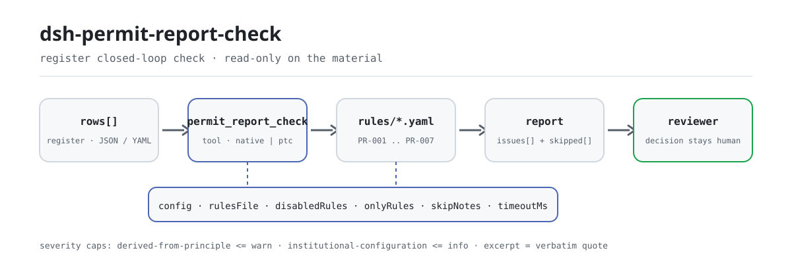

<div align="center">

<picture>
  <source media="(prefers-color-scheme: dark)" srcset="docs/assets/dsh-permit-report-check-flow-dark.svg">
  
</picture>

# dsh-permit-report-check

**Confira um registro de licenças administrativas linha por linha: você recebe uma lista de qual linha, qual coluna e o que falta; a decisão sobre a licença fica com o aprovador.**

Um plugin de verificação somente de dados para DeepSeek Harness: lê um registro de tramitação de licenças administrativas (o cabeçalho do requerente mais uma linha por pedido), aplica o pacote de regras versionado que acompanha (PR-001..PR-007) e lista apenas as diferenças que consegue apontar dentro do registro, sem parecer de conformidade nem juízo de responsabilidade.

[Instalar](#instalação-em-três-passos) · [Configuração](#configuração) · [FAQ](#faq) · [简体中文](README.md) · [English](README.en.md) · [Español](README.es.md) · [Português](README.pt.md) · [हिन्दी](README.hi.md)

[](LICENSE)
[](#compatibilidade)
[](https://www.npmjs.com/package/dsh-permit-report-check)
[](https://github.com/PerryLink/dsh-permit-report-check/actions/workflows/ci.yml)
[](#compatibilidade)

[](https://github.com/PerryLink/dsh-permit-report-check/stargazers)
[](https://www.npmjs.com/package/dsh-permit-report-check)
[](https://dshfind.com/plugins/PerryLink/dsh-permit-report-check?ref=badge)
[](https://securityscorecards.dev/viewer/?uri=github.com/PerryLink/dsh-permit-report-check)
[](https://dsh.market/)
[](https://gitee.com/perrylink/dsh-permit-report-check)

```sh
dsh plugin --profile <name> add dsh-permit-report-check
```

</div>

<sub>Plugin da comunidade, não afiliado à DeepSeek. Repositório canônico: <https://github.com/PerryLink/dsh-permit-report-check> (o Gitee é um espelho).</sub>

## O que é

`dsh-permit-report-check` lê um registro de tramitação de licenças administrativas — o cabeçalho do requerente e uma linha por pedido — e confere o próprio ciclo fechado e a coerência interna desse registro: que cada material listado na coluna de materiais requeridos registre se foi apresentado, que a data de aceitação não seja posterior à data de decisão, que a data de decisão fique entre a aceitação e a data de conclusão prometida que o próprio registro declara, que o resultado da decisão venha do vocabulário que você configurar, que um registro cujo resultado indica deferimento traga seu número de licença, que o cabeçalho nomeie o requerente e o assunto, e que nenhum assunto seja registrado duas vezes.

- **Para quem**: equipe de balcão de aprovação administrativa e de conformidade; não é preciso usar a linha de comando: entregue o material no chat.
- **O que você entrega**: o material original sobre o qual a verificação trabalha (uma tabela, um registro ou um documento); o original nunca é modificado. O Excel pode ser convertido antes para JSON/YAML, inclusive no chat quando a plataforma permitir.
- **O que você recebe**: uma lista de «qual linha, qual coluna, o que falta»; cada verificação que não pôde rodar aparece em `skipped` com o motivo.
- **O que ele não faz**: não dá parecer de conformidade, não determina responsabilidade e não substitui o revisor; apenas lista diferenças.

## Instalação em três passos

1. **Instale** (escolha um canal):

   ```sh
   # canal git (último main; equivale a git+https://github.com/PerryLink/dsh-permit-report-check.git)
   dsh plugin --profile <name> add github:PerryLink/dsh-permit-report-check
   # canal npm (versões publicadas)
   dsh plugin --profile <name> add dsh-permit-report-check
   # canal tarball: após pnpm pack neste repositório
   dsh plugin --profile <name> add ./dsh-permit-report-check-<version>.tgz
   ```

2. **Configuração mínima** (os padrões já funcionam; uma linha bundle sem `config` usa todos os padrões, com o caminho do pacote de regras apontando para o `rules/permit-report-check.yaml` incluído):

   ```yaml
   - insert:
       - id: dsh-permit-report-check
         name: dsh-permit-report-check
   ```

3. **Verifique se foi montado**:

   ```sh
   dsh --profile <name> --dump-config | grep 'dsh-permit-report-check'
   ```

   Depois rode o exemplo incluído (primeiro `pnpm run build` para gerar `lib/`):

   ```sh
   node samples/quickstart/run.mjs
   ```

   Saída (coincide com `samples/quickstart/expected/result.json`):

   ```text
   permit_report_check: 1 issue(s) — error 0, warn 1, info 0
   skipped: 1
   ```

   Captura: `docs/assets/quickstart.png`.

**Desinstalar**: `dsh plugin --profile <name> remove dsh-permit-report-check` (ou remova a linha do patch do perfil).

<details>
<summary>Usar no WorkBuddy / Coze</summary>

Busque «Professional Document Check Suite» no WorkBuddy / Coze (o conjunto completo; esta verificação é uma das partes; disponibilidade conforme a loja) para acessar a mesma capacidade sem linha de comando.

</details>

<details>
<summary>Instalar pelo mercado do DSH Desktop</summary>

Todos os plugins da PerryLink podem ser explorados no mercado embutido do DSH Desktop: **Market → Sources → add source → colar** `https://perrylink-dsh-catalog.perrylink.workers.dev/catalog-source.json` **→ selecionar**. A instalação ainda passa pela verificação de identidade npm do mercado e pela sua confirmação.

</details>

## Capacidades principais

`dsh-permit-report-check` registra a ferramenta `permit_report_check`: lê um registro de tramitação de licenças administrativas (o cabeçalho do requerente mais uma linha por pedido), aplica o pacote de regras versionado e devolve um relatório.

- **Sete regras em um único pacote** — o pacote de regras é dado, não código (`rules/permit-report-check.yaml`); trocá-lo troca todo o conjunto de verificações sem tocar em uma linha de TypeScript.
- **Somente leitura sobre o material** — aceita JSON ou YAML e nunca altera o original; ESM puro, sem requisições de rede nem chamadas ao modelo.
- **Sem citações inventadas** — cada regra traz `document` / `number` / `clause` / `excerpt` / `kind` / `source`; `excerpt` precisa ser citação literal, e uma regra cujo texto não foi obtido diz isso no próprio `excerpt` e é marcada como `derived-from-principle`.
- **A severidade segue a evidência** — `derived-from-principle` tem teto em `warn`, configuração institucional (`institutional-configuration`) em `info`, e um teste garante esse teto.
- **Lista vazia ≠ nada errado** — toda verificação que não pôde rodar entra em `skipped` com o motivo; uma regra cuja lista exigida não está configurada se reporta em `skipped` em vez de passar em silêncio.
- **Redação que não julga** — o relatório apenas lista diferenças, nunca juízo de conformidade, responsabilidade ou correção; um guardião de redação impõe isso e todo relatório traz o aviso de isenção.

| Regra | Verifica | Severidade | Tipo de base |
|---|---|---|---|
| `PR-001` | cada material listado registra sua apresentação | warn | principle |
| `PR-002` | a aceitação não é posterior à decisão | warn | principle |
| `PR-003` | a decisão fica entre a aceitação e a data prometida | info | local |
| `PR-004` | o resultado vem do seu vocabulário (desligada de fábrica) | info | local |
| `PR-005` | um deferimento registra seu número de licença | warn | principle |
| `PR-006` | o registro nomeia requerente e assunto | warn | principle |
| `PR-007` | os assuntos não são registrados duas vezes | warn | principle |

### Superfície da ferramenta

`permit_report_check` aceita quatro argumentos e é somente leitura do começo ao fim:

| Argumento | Tipo | Observações |
|---|---|---|
| `file` | string | Caminho absoluto do material (JSON ou YAML); um de `file` / `material` |
| `material` | string | Texto do material em linha (JSON ou YAML); um de `file` / `material` |
| `rulesFile` | string | Substitui o caminho configurado do pacote de regras (relativo à raiz do pacote ou absoluto) |
| `only` | string[] | Executa apenas estes ids de regra; vazio mantém o `onlyRules` configurado |

### Exemplos

São os pontos de entrada reais do plugin; instale uma vez e chame um. A primeira linha é o percurso detalhado, as demais são casos curtos.

**Exemplo detalhado** — ferramenta `permit_report_check`, entrada:

```json
{"applicant":"某某公司","matter":"某某建设项目环评审批","rows":[{"序号":"1","许可事项":"建设项目环境影响评价文件审批","申请材料":"环境影响报告书全本及公众参与说明","已提交材料":""}]}
```

Saída:

```json
{
  "id": "dsh-permit-report-check.PR-001.de09b5a6",
  "ruleId": "PR-001",
  "severity": "warn",
  "locator": {
    "row": 1,
    "field": "requiredItems"
  },
  "found": "第 1 行「requiredItems」为「环境影响报告书全本及公众参与说明」，但缺 submittedItems",
  "expected": "满足该条件的行应同时填写 submittedItems"
}
```

*Observed from `dsh-permit-report-check/tests/fixtures/PR-001/PR-001-unsafe.json`*

É a saída real do plugin sobre o próprio fixture `PR-001`, não uma ilustração. O pacote de regras não inventa citações, então cada achado indica tanto a disposição invocada quanto o fato de o texto dela não ter sido obtido nesta revisão.

| Você pergunta | O que responde |
|---|---|
| Uma linha lista materiais na coluna de materiais requeridos, mas a coluna de materiais apresentados está vazia: isso é reportado? | Sim. `PR-001` exige um valor `submittedItems` em toda linha cuja célula de materiais esteja preenchida e reporta a linha quando a coluna de apresentação está vazia. Ele lê a coluna de materiais do próprio registro e verifica apenas se a apresentação foi registrada: não compara essa lista com o guia de serviço do assunto nem julga se os materiais apresentados são completos ou conformes. Se nenhuma linha tiver a célula de materiais preenchida, a regra se reporta em `skipped`. |
| A data de aceitação é posterior à da decisão: isso é detectado? | Sim. `PR-002` compara as duas datas que o próprio registro carrega, `acceptedAt` contra `decidedAt`, considera o mesmo dia como não posterior e reporta a linha em que a aceitação vem depois da decisão. Ele compara apenas essas duas datas: não julga se a aceitação foi legal nem se o pedido deveria ter sido aceito. Uma data que não consegue interpretar é reportada como achado próprio, e não omitida em silêncio. |
| O que acontece quando a coluna da data de conclusão prometida está vazia, e a coluna de prazo legal é verificada? | `PR-003` se reporta em `skipped`: não há nenhum número de dias embutido, porque os prazos legais são contados em dias úteis, podem ser prorrogados e podem excluir o tempo de audiências ou pareceres, de modo que a única referência é a data de conclusão prometida (`dueAt`) declarada pelo registro. Nenhuma regra lê a coluna de prazo legal (`legalDays`). Quando `dueAt` está preenchido, a regra verifica se a data de decisão fica entre a aceitação e essa data; um achado significa que a decisão discorda do prazo que você registrou, nunca que ela atrasou. |
| Registrei um resultado como «deferido após correção»: isso é aceito? | `PR-004` confronta o resultado com o vocabulário do parâmetro `values`, e esse parâmetro vem vazio, então, como entregue, a regra se reporta em `skipped` em vez de julgar sua redação. Preencha `values` com os resultados que sua instituição registra e qualquer valor fora dessa lista é reportado. A regra verifica apenas se o valor está na lista; não julga se a decisão é correta ou legal. |
| Um registro diz deferido, mas a coluna do número de licença está vazia. | `PR-005` reporta: quando o resultado coincide com um marcador de deferimento — `conditionValues`, cujo conjunto padrão aparece em Configuração — o registro precisa trazer seu número de licença (`certificateNo`). Ele verifica apenas se o número está preenchido, não se o certificado é autêntico, válido ou entregue. Se nenhuma linha coincidir com um marcador de deferimento, a regra se reporta em `skipped`. |
| O mesmo assunto administrativo aparece em duas linhas. | `PR-007` reporta a linha posterior e nomeia a linha que ela duplica, porque dois registros de um mesmo assunto tornam a checagem de prazo ambígua. Ele verifica apenas unicidade, e um achado precisa de confirmação humana: um projeto que pede vários assuntos pode legitimamente parecer o mesmo, então distinga na coluna de materiais em vez de apagar a linha. Diferenças de espaço em branco são ignoradas; sem coluna de assunto, a regra se reporta em `skipped`. |

## Normas seguidas

| Documento | Número | Regras que o citam |
|---|---|---|
| Lei de Licenças Administrativas da República Popular da China | Versão vigente e numeração de artigos não verificadas nesta revisão | PR-001, PR-002, PR-005, PR-006, PR-007 |
| Guias de serviço e prazos prometidos de cada assunto (configuração institucional) | Sem norma nacional (a base é a data de conclusão prometida escrita no registro) — ⚠️ o teto legal está no artigo 42 da Lei de Licenças Administrativas; esta regra não o cita | PR-003 |
| Critério de gestão de licenças desta instituição (configuração institucional) | Sem norma nacional (a base é o vocabulário de resultados da instituição) — ⚠️ os tipos legais de decisão estão no artigo 38; esta regra não os cita | PR-004 |

**Limite:** este plugin confere um **registro de tramitação de licenças administrativas** no ciclo fechado que um registro pode sustentar: que cada material do pedido registre sua apresentação, que a aceitação não venha depois da decisão, que a decisão fique entre a aceitação e a data de conclusão prometida, que o resultado venha do seu vocabulário, que um deferimento registre seu número de licença, que o registro nomeie requerente e assunto, e que os assuntos não sejam registrados duas vezes. **Não** decide se uma decisão de licença foi legal, se os materiais estavam completos ou conformes, se um pedido deveria ser aceito nem se uma licença deveria ser concedida.

> ### ⚠️ O que este plugin deliberadamente não julga
>
> **Ele não verifica se a lista de materiais está completa.** Ele lê a coluna de materiais do **próprio** registro e verifica se cada item listado registra sua apresentação — **não** se essa lista coincide com o guia de serviço do assunto. Verificar a lista significa compará-la com o guia, e este plugin não faz isso.
>
> **Nenhum prazo legal está embutido — e a lei explica por que essa é a decisão correta.** A Lei de Licenças Administrativas foi lida literalmente (ver `rules/evidence/clause-verification.md`), e três de suas disposições tornam um número embutido inutilizável: **o artigo 82 exige contar os prazos em dias úteis, excluídos os feriados**; o artigo 42 fixa vinte dias com prorrogação de dez (quarenta e cinco mais quinze no trâmite conjunto); e o artigo 45 exclui do cômputo o tempo de audiências, testes, inspeções e pareceres. Um registro normalmente guarda datas de calendário, então `PR-003` compara a data de decisão com a **data de conclusão prometida escrita no registro** e se reporta em `skipped` quando essa coluna está vazia. Um achado significa «isto discorda do prazo que você registrou», nunca «isto atrasou».
>
> ⚠️ **O texto lido é a promulgação de 2003**; existe uma emenda de 2019 e **não foi obtida**, por isso o pacote mantém em cada regra a nota de que a versão vigente e a numeração dos artigos não foram verificadas, e não afirma que qualquer artigo seja direito vigente.
>
> **O vocabulário de resultados vem vazio.** A redação de deferimentos, indeferimentos e encerramentos varia por instituição e assunto, então `PR-004` se reporta em `skipped` até você configurá-lo, e `PR-005` (que exige número de licença quando há deferimento registrado) usa um conjunto configurável de marcadores de deferimento em vez de uma lista embutida.
>
> **Cada `excerpt` do pacote de regras diz, com todas as letras, que o texto do dispositivo não foi obtido.** O regime está na Lei de Licenças Administrativas e no guia de serviço de cada assunto. A revisão não conseguiu recuperar o texto literal, então o pacote declara a lacuna no próprio campo `excerpt` e mantém cada regra em `warn` ou `info`. **Quando os textos estiverem disponíveis, substitua cada `excerpt` pelo dispositivo real e eleve `kind` para `direct`.**

## Configuração

Todos os ajustes são campos Schemastery `Config` em `src/config.ts` (alteráveis pelo cordis.yml); os limites por regra ficam no pacote de regras em `rules/`. Uma substituição por id substitui a linha inteira: repita todas as chaves necessárias.

| Chave | Tipo | Padrão | Descrição |
|---|---|---|---|
| `rulesFile` | string | `rules/permit-report-check.yaml` | Caminho do pacote de regras, relativo à raiz do pacote |
| `disabledRules` | string[] | `[]` | Ids de regras que deixam de rodar; cada um aparece em `skipped` |
| `onlyRules` | string[] | `[]` | Executa apenas estes ids de regra; vazio executa todas |
| `skipNotes` | string | `""` | Nota anexada a cada motivo de `skipped` |
| `timeoutMs` | number | `120000` | Orçamento cooperativo de timeout da ferramenta |

Parâmetros por regra que vale conhecer:

- `PR-001` `conditionField` / `requiredFields` — qual coluna dispara a exigência: célula de materiais preenchida exige a coluna de apresentação.
- `PR-003` `notAfterField` — comparado com `dueAt` (data de conclusão prometida); o plugin nunca deduz prazo a partir de número de dias.
- `PR-004` `values` — seu vocabulário de resultados; vazio significa sem verificação. Exemplo de forma:

```yaml
values: [deferido, indeferido, não aceito, encerrado, deferido após correção]
```

- `PR-005` `conditionValues` — os valores que marcam deferimento. O conjunto padrão incluído é:

```text
准予 / 准予许可 / 通过 / 同意 / 已办结 / 批准
```

- `PR-006` `fields` — campos que precisam aparecer no cabeçalho, padrão `[applicant, matter]`; acrescente `window` se o seu formulário também registra o balcão.
- `PR-007` `field` — a coluna que precisa ser única, por padrão a do assunto (`permitType`).

Exemplo de substituição no patch do perfil:

```yaml
- insert:
    - id: dsh-permit-report-check
      name: dsh-permit-report-check
      config:
        disabledRules: [PR-004]
        timeoutMs: 180000
```

## Formato do material

A ferramenta aceita JSON ou YAML:

```yaml
applicant: 某某公司
matter: 某某建设项目环评审批
window: 综合受理窗口
rows:
  - { 序号: '1', 许可事项: 建设项目环境影响评价文件审批, 许可机关: 某某生态环境局,
      法定依据: 《中华人民共和国环境影响评价法》第二十二条,
      申请材料: 环境影响报告书全本及公众参与说明,
      已提交材料: 已提交报告书全本（含公众参与说明），受理编号 SL-2026-018,
      受理日期: 2026-03-02, 法定时限: '60', 承诺办结日: 2026-04-30,
      决定日期: 2026-04-20, 决定结果: 准予, 许可证号: 某环审〔2026〕18 号, 承办人: 王工 }
```

Os nomes de coluna são comparados sem diferenciar maiúsculas e ignorando espaços, sublinhados e hífens; os nomes do próprio registro são preservados, então um achado nomeia a coluna que leu. Os campos são opcionais na camada de leitura e validados pelo motor de verificação, de modo que uma exportação parcial produz diferenças de «item faltando» em vez de quebrar a ferramenta.

## Origem das regras

Os dados das regras ficam em `rules/permit-report-check.yaml`, separados do código: cada regra traz documento, número, o número do dispositivo conforme o sistema de numeração da própria fonte, uma citação literal e uma URL de origem. O cabeçalho do pacote declara a lacuna de citações por inteiro e a `note` de cada regra repete a parte que lhe diz respeito. O guardião de carga que normalmente exige «citação literal de pelo menos oito caracteres» não distingue citação de descrição, então este pacote se apoia no cabeçalho, nas notas por regra e em um teste que garante que cada `excerpt` reconhece a lacuna. Um pacote que exagere sua base falha ao carregar em vez de produzir um relatório com aparência de solidez. Os limites estabelecidos na verificação e as conclusões deliberadamente não tiradas acompanham o pacote em `rules/evidence/`.

## FAQ

<details>
<summary>Ele vai decidir por nós o deferimento ou o indeferimento?</summary>

Não. Ele lista apenas as diferenças que consegue apontar dentro do material (qual linha, qual coluna, o que falta), não faz juízo de fato nem avalia legalidade: a decisão da licença fica com o aprovador. Um guardião de redação restringe a forma do relatório e todo relatório traz o aviso de isenção.

</details>

<details>
<summary>Meu registro está em Excel: posso usar direto?</summary>

Sim: converta antes para JSON ou YAML; quando a plataforma permite, a conversão pode ser feita no chat. A ferramenta só lê o material e nunca altera o original.

</details>

<details>
<summary>Por que não há um número de dias legal embutido?</summary>

Porque a própria lei torna um número embutido inutilizável: o artigo 82 conta os prazos em dias úteis, excluídos os feriados; o artigo 42 fixa vinte dias com prorrogação de dez (quarenta e cinco mais quinze no trâmite conjunto); e o artigo 45 exclui do cômputo os tempos de audiência, testes, inspeção e parecer. Um registro normalmente guarda datas de calendário, então `PR-003` compara apenas com a data de conclusão prometida (`dueAt`) declarada pelo registro; com essa coluna vazia, a regra cai em `skipped` em vez de supor um prazo por você.

</details>

<details>
<summary>Uma lista `issues` vazia pode ser lida como «nada errado»?</summary>

Não. Toda verificação que não pôde rodar está em `skipped` com o motivo (data de conclusão prometida vazia, `values` não configurado, regra desativada). Leia `issues` e `skipped` juntos.

</details>

<details>
<summary>Ele acessa a rede ou envia o registro? Qual é o custo?</summary>

Sem rede, sem chamadas ao modelo e sem escrita de arquivos: leitura, comparação e aritmética de datas acontecem localmente, e o material chega apenas pelos argumentos da ferramenta. Para um trimestre inteiro de registros ou um diretório completo, o modo `ptc` paga o custo do schema uma única vez; `timeoutMs` (120000 ms por padrão) é um orçamento cooperativo de timeout.

</details>

## Solução de problemas

- **O plugin instala, mas a ferramenta não aparece.** Confira se `main` resolve para `lib/index.mjs` e se `pnpm run build` o gerou; um `main` errado faz o carregador pular a entrada em silêncio.
- **`dsh plugin add` recusa o pacote como incompatível.** A faixa de peers cobre `0.1.x` e `0.2.x`; se o seu runtime estiver fora dela, conceda uma isenção explícita: `dsh plugin --profile <name> allow-version dsh-permit-report-check@0.1.0 --dsh-version <runtime> --accept-risk`
- **`check` marca `manifest-peers` como falha.** O verificador estático compara com uma faixa de peers codificada anterior à linha 0.2. O runtime aplica a compatibilidade de peers na instalação, então a faixa declarada é a correta; é um problema conhecido do `dsh-plugin-dev`.
- **Uma regra não rodou.** Veja o array `skipped`: ele indica o id da regra e o motivo.
- **Instalou, mas não vejo achados.** Confirme que a ferramenta rodou e devolveu resultado: resultado vazio não é o mesmo que execução pulada; depois confira os nomes de coluna do material contra a tabela de regras, porque falta de dado costuma virar `skipped`, não um achado adivinhado.
- **`PR-003` se reporta em `skipped`.** O registro não anota data de conclusão prometida. Prazos variam por assunto e podem ser prorrogados, então o plugin não inventa um.
- **`PR-003` dispara, mas considero o trâmite em prazo.** O achado significa que a data de decisão discorda da data de conclusão prometida registrada: ou o prazo foi calculado errado, ou a data de decisão está errada.
- **`PR-001` não pegou um material faltando.** Ele confere a lista do próprio registro, não a do guia de serviço; se a lista está completa é uma comparação que este plugin não faz.
- **`PR-004` nunca roda.** O vocabulário vem vazio; preencha `values` com os resultados que sua instituição registra.
- **`PR-005` dispara em um deferimento sem número de licença.** Ou a licença ainda não foi emitida, ou a coluna ficou em branco. Se o seu registro usa outra redação de deferimento, restrinja `conditionValues`.
- **Um achado diz que o texto do dispositivo não foi obtido.** O pacote de regras tem uma porta de citações e nunca inventa texto; quando o texto não está disponível, o achado fica em `warn`/`info` e diz isso no `excerpt`. Trate como lacuna de verificação, não como prova de que o material cumpre.
- **Tudo é `warn` ou `info`.** Por projeto: este verificador não faz qualificação legal; ele reporta diferenças e uma pessoa decide o que fazer.
- **Os horários parecem deslocados.** Toda a aritmética é de relógio de parede sobre as strings de entrada; nenhuma conversão de fuso horário é aplicada.

## Compatibilidade

| Superfície | Estado |
|---|---|
| Harness | Faixa de peers `>=0.1.2-rc.1 <0.2.0 \|\| >=0.2.0-0 <0.3.0` — verificado com `0.2.0-rc.2` e `0.2.1-rc.2`. `engines.dsh` é declarado como `>=0.2.1-0 <0.3.0` e é aplicado pelo host desde 0.2.1 |
| Node | `^22.19.0 \|\| >=24.0.0` |
| Plataformas | Todas (ESM puro; sem código nativo, sem rede, sem chamada ao modelo) |
| Modo de ferramenta | Funciona em `native` e `ptc`; para um diretório inteiro de registros use `ptc` |

**Interoperabilidade**: o pacote declara exatamente uma capacidade, `tools:register` (`package.json#dsh.capabilities`), registra uma única ferramenta com namespace `permit_report_check`, não fornece service key, não registra slot de cliente nem prefixo `webServer`, e seu patch de bundle apenas faz `insert` da própria linha: nunca sobrescreve a `config` de uma linha embutida. Por isso não disputa com outros plugins nomes de ferramenta, service keys, slots ou rotas HTTP.

## Ecossistema e qualidade

- [Espelho no Gitee](https://gitee.com/perrylink/dsh-permit-report-check) (espelho sincronizado; o GitHub é a referência)
- [Página no dshfind](https://dshfind.com/plugins/PerryLink/dsh-permit-report-check) (instalações e ranking)
- [Relatório OpenSSF Scorecard](https://securityscorecards.dev/viewer/?uri=github.com/PerryLink/dsh-permit-report-check) (gerado por [.github/workflows/scorecard.yml](.github/workflows/scorecard.yml))
- [DSH Market](https://dsh.market/) (listado)
- **Canal da loja 1024**: `npm i -g dsh1024` uma vez, depois `dsh1024 plugin --profile <name> add dsh-permit-report-check` (conta para o ranking de instalações do [deepseek1024.com](https://deepseek1024.com))
- [Base de conhecimento do ecossistema](https://perrylink.github.io/dsh-plugin-guide/) — dados medidos, não marketing: guia de desenvolvimento de plugins · dados de seleção · critérios de manutenção

## Desenvolvimento

```sh
pnpm install                                        # node ^22.19 || >=24
pnpm run typecheck                                  # tsc --noEmit
pnpm test                                           # vitest: suíte compartilhada de plugins de tabela + fixtures pareados
pnpm run build                                      # tsdown -> lib/index.mjs + lib/index.d.mts
pnpm run verify:self-contained                      # as dependências resolvem pelo registry
pnpm run check:lockfile                             # checagem de deriva do lockfile
pnpm run check:readmes                              # consistência dos README em cinco idiomas
pnpm run check:citations                            # linha de base de citações do pacote de regras
node ../scripts/sync-shared.mjs dsh-permit-report-check   # atualiza src/shared a partir de ../_shared
pnpm pack                                           # o tarball publicado
```

O plugin é **somente dados**: `src/model.ts` declara a forma da tabela, o kit compartilhado fornece o leitor e o motor de verificação, e o pacote de regras declara cada checagem; uma verificação que caiba em um tipo existente só precisa de edição no pacote de regras. Execução local do exemplo (primeiro `pnpm run build`):

```sh
node samples/quickstart/run.mjs --json
# => {"tool":"permit_report_check","issueCount":1,"summary":{"error":0,"warn":1,"info":0},"skippedCount":1}
```

A entrada do exemplo fica em `samples/quickstart/input/`, a saída esperada em `samples/quickstart/expected/result.json` e a captura em `docs/assets/quickstart.png`. As imagens do README são geradas por programa por [`scripts/gen-readme-assets.py`](scripts/gen-readme-assets.py) (Python + Pillow) e podem ser reexecutadas: `python scripts/gen-readme-assets.py`; o diagrama de fluxo e as imagens de demonstração antigos permanecem em `docs/assets/` para links externos, enquanto os READMEs referenciam apenas o novo par claro/escuro.

Topics: `deepseek-harness`, `dsh`, `dsh-plugin`, `cordis`, `permit`, `report`

## Família e agradecimentos

Este projeto faz parte da família de plugins do DeepSeek Harness mantida pela [PerryLink](https://github.com/PerryLink) (todos Apache-2.0). O índice completo é [escolha um verificador por material](https://perrylink.github.io/zh/checkers/choose/). Se ele for útil, **uma estrela ajuda a próxima pessoa a encontrá-lo**: nada fica bloqueado por isso.

- [@PerryLink](https://github.com/PerryLink) — criador e mantenedor: o pacote de regras somente de dados (PR-001..PR-007), a ferramenta `permit_report_check`, o registro de verificação de citações (`rules/evidence/`) e a documentação em cinco idiomas.

<details>
<summary>Expandir todos os plugins</summary>

| Plugin | Status |
|---|---|
| **[dsh-aqua-input-check](https://github.com/PerryLink/dsh-aqua-input-check)** |  |
| **[dsh-archive-check](https://github.com/PerryLink/dsh-archive-check)** |  |
| **[dsh-auto-review](https://github.com/PerryLink/dsh-auto-review)** |  |
| **[dsh-autotier](https://github.com/PerryLink/dsh-autotier)** | 🧊 CONGELADO — ver o README do repo |
| **[dsh-bid-ca-precheck](https://github.com/PerryLink/dsh-bid-ca-precheck)** |  |
| **[dsh-bid-qual-check](https://github.com/PerryLink/dsh-bid-qual-check)** |  |
| **[dsh-cert-mcp](https://github.com/PerryLink/dsh-cert-mcp)** | 🧊 CONGELADO — ver o README do repo |
| **[dsh-checkpoint-rewind](https://github.com/PerryLink/dsh-checkpoint-rewind)** |  |
| **[dsh-click](https://github.com/PerryLink/dsh-click)** |  |
| **[dsh-composer-history](https://github.com/PerryLink/dsh-composer-history)** |  |
| **[dsh-contract-stance](https://github.com/PerryLink/dsh-contract-stance)** |  |
| **[dsh-customs-doc-check](https://github.com/PerryLink/dsh-customs-doc-check)** |  |
| **[dsh-data-quality](https://github.com/PerryLink/dsh-data-quality)** | 🧊 CONGELADO — ver o README do repo |
| **[dsh-demurrage-ledger](https://github.com/PerryLink/dsh-demurrage-ledger)** |  |
| **[dsh-doublecheck](https://github.com/PerryLink/dsh-doublecheck)** |  |
| **[dsh-drill-script-check](https://github.com/PerryLink/dsh-drill-script-check)** |  |
| **[dsh-eia-guide-check](https://github.com/PerryLink/dsh-eia-guide-check)** |  |
| **[dsh-emergency-plan](https://github.com/PerryLink/dsh-emergency-plan)** |  |
| **[dsh-essay-rubric-check](https://github.com/PerryLink/dsh-essay-rubric-check)** |  |
| **[dsh-evidence-check](https://github.com/PerryLink/dsh-evidence-check)** |  |
| **[dsh-export-ctl-check](https://github.com/PerryLink/dsh-export-ctl-check)** |  |
| **[dsh-fast](https://github.com/PerryLink/dsh-fast)** |  |
| **[dsh-fmea-table-check](https://github.com/PerryLink/dsh-fmea-table-check)** |  |
| **[dsh-forecast-penalty](https://github.com/PerryLink/dsh-forecast-penalty)** |  |
| **[dsh-fund-research](https://github.com/PerryLink/dsh-fund-research)** |  |
| **[dsh-github](https://github.com/PerryLink/dsh-github)** |  |
| **[dsh-gongwen-flow-check](https://github.com/PerryLink/dsh-gongwen-flow-check)** |  |
| **[dsh-gongwen-word-check](https://github.com/PerryLink/dsh-gongwen-word-check)** |  |
| **[dsh-guard-plan-qc](https://github.com/PerryLink/dsh-guard-plan-qc)** |  |
| **[dsh-hazchem-check](https://github.com/PerryLink/dsh-hazchem-check)** |  |
| **[dsh-hazplan-check](https://github.com/PerryLink/dsh-hazplan-check)** |  |
| **[dsh-hidden-risk-map](https://github.com/PerryLink/dsh-hidden-risk-map)** |  |
| **[dsh-hs-classify](https://github.com/PerryLink/dsh-hs-classify)** |  |
| **[dsh-icd-rule-check](https://github.com/PerryLink/dsh-icd-rule-check)** |  |
| **[dsh-industry-research](https://github.com/PerryLink/dsh-industry-research)** |  |
| **[dsh-lawcite-adapter](https://github.com/PerryLink/dsh-lawcite-adapter)** |  |
| **[dsh-laya](https://github.com/PerryLink/dsh-laya)** |  |
| **[dsh-lc-doc-check](https://github.com/PerryLink/dsh-lc-doc-check)** |  |
| **[dsh-learning-gap-check](https://github.com/PerryLink/dsh-learning-gap-check)** |  |
| **[dsh-library](https://github.com/PerryLink/dsh-library)** |  |
| **[dsh-local-ai](https://github.com/PerryLink/dsh-local-ai)** |  |
| **[dsh-lsp-actions](https://github.com/PerryLink/dsh-lsp-actions)** |  |
| **[dsh-mask](https://github.com/PerryLink/dsh-mask)** |  |
| **[dsh-mcp-panel](https://github.com/PerryLink/dsh-mcp-panel)** |  |
| **[dsh-medrec-qc](https://github.com/PerryLink/dsh-medrec-qc)** |  |
| **[dsh-memento](https://github.com/PerryLink/dsh-memento)** | 🧊 CONGELADO — ver o README do repo |
| **[dsh-nsfc-form-check](https://github.com/PerryLink/dsh-nsfc-form-check)** |  |
| **[dsh-nurse-record-check](https://github.com/PerryLink/dsh-nurse-record-check)** |  |
| **[dsh-observe](https://github.com/PerryLink/dsh-observe)** |  |
| **[dsh-origin-rvc-check](https://github.com/PerryLink/dsh-origin-rvc-check)** |  |
| **[dsh-ota-review-check](https://github.com/PerryLink/dsh-ota-review-check)** |  |
| **[dsh-output-styles](https://github.com/PerryLink/dsh-output-styles)** |  |
| **[dsh-paper-doc-adapter](https://github.com/PerryLink/dsh-paper-doc-adapter)** |  |
| **[dsh-permission-rules](https://github.com/PerryLink/dsh-permission-rules)** |  |
| **[dsh-permit-report-check](https://github.com/PerryLink/dsh-permit-report-check)** |  |
| **[dsh-pipeline-check](https://github.com/PerryLink/dsh-pipeline-check)** |  |
| **[dsh-pleading-draft](https://github.com/PerryLink/dsh-pleading-draft)** |  |
| **[dsh-plugin-doctor](https://github.com/PerryLink/dsh-plugin-doctor)** | 🚫 APOSENTADO (repo arquivado) |
| **[dsh-plugin-guide](https://github.com/PerryLink/dsh-plugin-guide)** |  |
| **[dsh-plugin-kit](https://github.com/PerryLink/dsh-plugin-kit)** | 🚫 APOSENTADO (repo arquivado) |
| **[dsh-plugin-upgrade](https://github.com/PerryLink/dsh-plugin-upgrade)** | 🚫 APOSENTADO (repo arquivado) |
| **[dsh-policy-brief-draft](https://github.com/PerryLink/dsh-policy-brief-draft)** |  |
| **[dsh-power-loss-split](https://github.com/PerryLink/dsh-power-loss-split)** |  |
| **[dsh-power-ticket-check](https://github.com/PerryLink/dsh-power-ticket-check)** |  |
| **[dsh-ppap-check](https://github.com/PerryLink/dsh-ppap-check)** |  |
| **[dsh-protest-deadline](https://github.com/PerryLink/dsh-protest-deadline)** |  |
| **[dsh-railway-window](https://github.com/PerryLink/dsh-railway-window)** |  |
| **[dsh-repair-order-qc](https://github.com/PerryLink/dsh-repair-order-qc)** |  |
| **[dsh-research-report](https://github.com/PerryLink/dsh-research-report)** |  |
| **[dsh-review-reply-check](https://github.com/PerryLink/dsh-review-reply-check)** |  |
| **[dsh-rulefile-check](https://github.com/PerryLink/dsh-rulefile-check)** |  |
| **[dsh-safety-brief-check](https://github.com/PerryLink/dsh-safety-brief-check)** |  |
| **[dsh-score](https://github.com/PerryLink/dsh-score)** | 🧊 CONGELADO — ver o README do repo |
| **[dsh-session-sync](https://github.com/PerryLink/dsh-session-sync)** |  |
| **[dsh-site-log-check](https://github.com/PerryLink/dsh-site-log-check)** |  |
| **[dsh-skill-pack-security](https://github.com/PerryLink/dsh-skill-pack-security)** |  |
| **[dsh-soe-decision-check](https://github.com/PerryLink/dsh-soe-decision-check)** |  |
| **[dsh-soilwater-check](https://github.com/PerryLink/dsh-soilwater-check)** |  |
| **[dsh-sop-sync-check](https://github.com/PerryLink/dsh-sop-sync-check)** |  |
| **[dsh-spc-gbt-adapter](https://github.com/PerryLink/dsh-spc-gbt-adapter)** |  |
| **[dsh-talk](https://github.com/PerryLink/dsh-talk)** |  |
| **[dsh-tender-extract](https://github.com/PerryLink/dsh-tender-extract)** |  |
| **[dsh-tender-matrix](https://github.com/PerryLink/dsh-tender-matrix)** |  |
| **[dsh-test-drive](https://github.com/PerryLink/dsh-test-drive)** |  |
| **[dsh-ticktick](https://github.com/PerryLink/dsh-ticktick)** | 🚫 APOSENTADO (repo arquivado) |
| **[dsh-translate](https://github.com/PerryLink/dsh-translate)** |  |
| **[dsh-warranty-calc](https://github.com/PerryLink/dsh-warranty-calc)** |  |
| **[dsh-budget](https://github.com/PerryLink/dsh-budget)** | 🧊 CONGELADO — ver o README do repo |
| **[dsh-claude-move](https://github.com/PerryLink/dsh-claude-move)** | 🧊 CONGELADO — ver o README do repo |
| **[dsh-defend](https://github.com/PerryLink/dsh-defend)** | 🧊 CONGELADO — ver o README do repo |
| **[dsh-draw](https://github.com/PerryLink/dsh-draw)** | 🧊 CONGELADO — ver o README do repo |
| **[dsh-reach](https://github.com/PerryLink/dsh-reach)** | 🧊 CONGELADO — ver o README do repo |
| **[dsh-background-agents](https://github.com/PerryLink/dsh-background-agents)** | 🚫 APOSENTADO (repo arquivado) |
| **[dsh-session-pin](https://github.com/PerryLink/dsh-session-pin)** | 🚫 APOSENTADO (repo arquivado) |
| **[dsh-team-rooms](https://github.com/PerryLink/dsh-team-rooms)** | 🚫 APOSENTADO (repo arquivado) |

</details>

## License

[LICENSE](LICENSE) (Apache License 2.0) © 2026 dsh-permit-report-check contributors

<p align="center"><sub>Apache-2.0 · Plugin da comunidade, não afiliado à DeepSeek.</sub></p>
